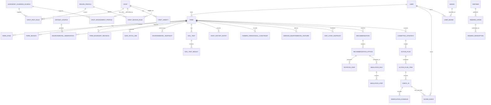

# AGROSPACE QUEST — MASTER AI-AGENT HANDOFF
## Integrated Project Brief, Backend Architecture, NASA Data Deep Dive, Agronomy Guide, and Build Playbook

**Challenge:** NASA Space Apps Challenge 2026 — *Field Shift: Adapting Farms with NASA Data*  
**Project/product name:** AgroSpace Quest: The Elemental Balance  
**Document type:** Single attachment for an AI research, architecture, or coding agent  
**Primary stack:** Django + Django REST Framework + PostgreSQL/PostGIS + React  
**Supporting stack:** Python geospatial analysis, Celery/Redis for background processing, optional grounded AI agents  
**Document status:** Consolidated from the backend specification and two team deep-dive documents; terminology and precedence notes added for agent clarity.

---

# READ THIS FIRST — INSTRUCTIONS FOR THE AI AGENT

You are receiving this file as the shared project context and technical reference for AgroSpace Quest. Read the entire document before proposing an architecture, writing code, changing a repository, or generating a final technical specification. Do not rely only on the first few sections.

## A. Your role

Act as a senior full-stack architect, Django REST Framework engineer, geospatial/data engineer, NASA Earth-observation researcher, agricultural decision-support designer, and careful technical writer. Your job is to turn this project context into an implementation-ready system design or implementation plan, depending on the user's explicit request.

## B. Primary objective — do not lose sight of the challenge

The central product is a **farmer-centered crop-rotation decision-support tool**. It combines NASA Earth observations, local soil information, crop characteristics, and farmer priorities to help users explore rotation strategies that may improve soil health and resilience to changing weather and water conditions.

It is not primarily a weather dashboard, satellite-image viewer, generic chatbot, leaderboard, or farming-themed game. The game elements are a presentation and engagement layer around a defensible agricultural decision-support workflow.

The product must compare at least three strategies, including the farmer's existing rotation. Every strategy must explain its rationale, evidence, potential benefits, trade-offs/risks, missing information, and need for local validation.

## C. Naming and terminology

- **FIELD SHIFT** is the official NASA challenge name.
- **AgroSpace Quest: The Elemental Balance** is the team's current product/experience name.
- In the 2026 challenge wording, **SI means Super Intelligence**, not spatial intelligence. NASA describes SI as an umbrella for AI-enabled capabilities, including machine learning, deep learning, language systems, decision support, foundation models, and agentic systems. Spatial analysis, statistics, and data fusion support the solution, but they are not themselves the definition of SI.
- The four “Elemental Gauges” are user-interface indicators. They must not be presented as direct scientific measurements unless the underlying variable really is measured that way.

## D. Source-of-truth and conflict-resolution rules

If two parts of this combined reference appear inconsistent, apply this order:

1. The official challenge statement and current official NASA/product documentation.
2. The scientific accuracy and safety rules in this opening section.
3. The explicit product requirements and MVP scope in the Project Plan appendix.
4. The detailed backend architecture in the Backend Technical Specification appendix.
5. The scientific, agronomic, dataset, modeling, and implementation guidance in the Deep Dive appendix.
6. Illustrative code, sample payloads, or conceptual examples elsewhere in the document.

Treat sample endpoints, code, values, crop traits, scores, resolutions, revisit intervals, and data-access details as examples until verified against current official documentation and the selected product/version. Never silently convert an illustrative example into a verified fact.

## E. Build scope: separate MVP, advanced work, and future work

Do not attempt to implement every idea in this file during a short hackathon.

### P0 — Minimum honest end-to-end prototype

1. One explicitly selected demonstration region and a local crop/season knowledge set.
2. Farm location selection; polygon drawing if feasible, with a point-plus-area fallback if necessary.
3. Farmer-entered current crop rotation, basic soil information, water availability, priorities, and practical constraints.
4. At least one working NASA data integration (NASA POWER is a practical starting point) and preferably one additional useful Earth-observation signal (for example GPM, SMAP context, or vegetation data).
5. A data-quality/provenance record: product, variable, unit, time period, spatial support/resolution, quality flags, and retrieval date where available.
6. A curated regional crop catalog and calendar with sourced crop properties.
7. Three rotation strategies: current/baseline plus two distinct alternatives. “Hydra Shield” and “Nitrogen Battery” are display labels, not hardcoded crop sequences.
8. Deterministic, explainable eligibility rules and multi-criteria comparisons.
9. A visual dashboard with the four gauges, with their meanings and limitations explained.
10. At least one working scenario/what-if simulation that is clearly labelled as a modeled scenario, not a forecast.
11. Strategy explanation with evidence, potential benefits, trade-offs, risks, unknowns, and a local-review prompt.
12. A basic commit/check-in workflow. A simple leaderboard can be demonstrated if the core flow is stable.

### P1 — Add only after P0 works reliably

- Polygon-based zonal statistics and meaningful field zones.
- Additional datasets such as ECOSTRESS, Landsat/MODIS vegetation products, elevation/terrain, or GRACE regional context.
- More advanced seasonal sliders and climate perturbation scenarios.
- PDF/CSV report export, localized wording, richer map overlays, and improved trend analysis.
- A grounded AI explanation assistant with source retrieval and strict output validation.

### P2 — Future production/research work

- Calibrated crop-growth models such as DSSAT or another locally validated model.
- Yield, disease, or pest-risk prediction models requiring appropriate training/validation data.
- Long-term soil-carbon projection.
- Full-scale raster infrastructure, multi-country integrations, expert/cooperative networks, automated partner rewards, and advanced monitoring.
- Autonomous multi-agent workflows. Do not let agents autonomously change agronomic rules, crop catalogs, weights, scores, or farmer plans.

## F. Non-negotiable scientific rules

- NASA POWER is not a future-weather forecast API. It provides historical and near-real-time meteorological/solar information. Use a separate forecast provider for actual forecasts, or label future outputs as scenarios based on explicit assumptions and historical statistics.
- SMAP soil-moisture products have a spatial footprint that may cover multiple fields. Never imply precise small-farm measurement or automatic proof of irrigation.
- ECOSTRESS land-surface temperature is not equivalent to 2-m air temperature. Coverage and repeat timing vary.
- GRACE/GRACE-FO water-storage information is regional/large-scale context, not a measurement for one small farm.
- GEDI is footprint/sample-based; it is not a wall-to-wall farm biomass map.
- NDVI/EVI are vegetation indicators, not direct soil-health or nutrient measurements.
- Do not claim that the listed satellite products directly provide laboratory-equivalent nitrogen, phosphorus, soil organic matter, pH, or texture values. Use soil tests, validated soil databases, or clearly labelled estimates.
- Resampling a coarse raster to a finer grid does not create new information or finer true resolution.
- Correlation does not prove causation. A soil-moisture change does not prove irrigation; a vegetation change does not prove a farmer action.
- Never treat missing data or poor satellite coverage as proof of poor farmer performance.
- Do not show a strategy score as guaranteed yield, guaranteed water savings, certified soil improvement, or agronomic certainty.
- Use region-specific crop calendars, crop suitability, market and agronomic rules. No universal crop sequence is appropriate everywhere.
- Farmers and local agricultural experts remain decision-makers. The tool supports judgment and must show where expert review is needed.

## G. Data and AI operating principles

1. Keep provider-specific NASA clients separate from the normalized environmental data model.
2. Store raw files/rasters in object storage or an appropriate data store; store metadata and references in PostgreSQL/PostGIS.
3. Preserve product/version, units, date/time, spatial support, quality flags, processing method, and source provenance.
4. Use background jobs for slow data retrieval, geospatial processing, report generation, and scheduled refreshes.
5. Cache normalized summaries and expose data freshness/coverage to the frontend.
6. The deterministic backend is the source of truth for measurements, derived features, eligibility, rankings, gauge calculations, and scenario outputs.
7. AI agents may search approved references, summarize backend outputs, identify candidate patterns, and explain results. They must not fabricate measurements, calculate or modify official scores, silently change crop rules, or execute arbitrary tools.
8. Separate observed data, ground/lab data, modeled estimates, statistical findings, assumptions, and future scenarios in both API contracts and UI labels.

## H. What the agent should deliver when asked to create/update a technical Markdown file

Produce one coherent, complete Markdown deliverable, not a short outline. It should include:

- Challenge alignment and acceptance checklist.
- MVP scope and future-work boundaries.
- System architecture and Mermaid diagrams.
- Django app structure and service boundaries.
- Database models, relationships, indexes, and PostGIS geometry design.
- NASA dataset/product research with official citations and verified access patterns.
- Environmental ingestion, normalization, harmonization, quality, uncertainty, caching, and background-job workflows.
- Local soil and crop knowledge models.
- Rotation eligibility, sequence generation, multi-criteria scoring, evidence and explanation contracts.
- Four gauges and scenario simulation methodology.
- DRF endpoint catalog with example requests/responses.
- Verification, check-ins, leaderboard, and future partner APIs.
- Security, testing, deployment, team roles, and realistic implementation sequence.
- References and explicit known limitations.

Before finalizing, cross-check that each feature has a backend responsibility, persistence design where necessary, API/workflow, validation rules, and acceptance test. Do not claim an implementation is complete merely because it appears in a design document.

## I. How to use the rest of this file

The following appendices preserve and combine the team's three source documents:

- **Appendix A:** The detailed backend/API/database/NASA integration specification. Use this for backend models, endpoints, workflows, task processing, and implementation architecture.
- **Appendix B:** The project plan and AI-agent playbook. Use this for scope, team execution, research workflow, source discipline, tool contracts, and the agent operating model.
- **Appendix C:** The scientific, data, agronomy, modeling, and technology deep dive. Use this for concepts, dataset selection, data fusion, rotation science, statistical methods, and validation.

These appendices are intentionally retained in full to avoid losing useful detail. Use the precedence rules above if duplicated sections differ.

---

# MASTER TABLE OF CONTENTS

- [Agent instructions and governing decisions](#read-this-first--instructions-for-the-ai-agent)
- [Appendix A — Backend Technical Specification](#appendix-a--backend-technical-specification)
- [Appendix B — Project Plan and AI-Agent Playbook](#appendix-b--project-plan-and-ai-agent-playbook)
- [Appendix C — Scientific, Data, Modeling, and Technology Deep Dive](#appendix-c--scientific-data-modeling-and-technology-deep-dive)

---


---

# APPENDIX A — BACKEND TECHNICAL SPECIFICATION

> **Source material:** `AgroSpace_Quest_Backend_Technical_Specification.md`. Content retained and nested into this master handoff.

## AgroSpace Quest: The Elemental Balance
### Backend, API, NASA Data, Database, and System Architecture

**Document type:** Revised universal technical specification  
**Backend stack:** Django + Django REST Framework (DRF) + PostgreSQL/PostGIS  
**Frontend:** React  
**Background processing:** Celery + Redis  
**Geospatial interface:** Mapbox or MapLibre + GeoJSON  
**Status:** Hackathon prototype architecture, with a clearly separated global-scaling roadmap

---

## 1. Executive Summary

AgroSpace Quest is a location-aware agricultural decision-support platform. A farmer selects or draws a farm on a map, provides basic information about their current farming routine and priorities, and receives an understandable explanation of the environmental conditions affecting that farm. The platform then compares crop-rotation strategies, simulates possible outcomes over future seasons, and supports seasonal check-ins, verification workflows, leaderboards, and localized rewards.

The backend must do more than expose CRUD endpoints. It has to coordinate several different kinds of work:

1. Store users, farms, field boundaries, farm zones, crops, seasons, and farmer preferences.
2. Request or retrieve NASA Earth-observation and climate datasets (POWER, GPM, SMAP, ECOSTRESS, Landsat, MODIS, GRACE/GRACE-FO, SRTM, and optional GEDI) plus appropriate non-NASA soil, crop, forecast, and market sources.
3. Convert data from different providers into a consistent internal format, with units, dates, spatial resolution, quality flags, and source provenance.
4. Generate crop-rotation recommendations using agricultural rules and a transparent scoring engine.
5. Run simulations without pretending that a scenario is a guaranteed forecast.
6. Manage farmer check-ins, evidence, expert review, score history, regional leaderboards, and partner rewards.
7. Continue working when an external data provider is delayed or temporarily unavailable.

In the 2026 challenge terminology, **SI means Super Intelligence**. It refers to AI-enabled capabilities such as machine learning, deep learning, natural-language systems, decision support, foundation models, and agentic systems. Statistical and geospatial methods—such as seasonal analysis, anomaly detection, vegetation time-series analysis, and resolution-aware data fusion—are supporting analytical methods; they are not synonyms for SI. For this project, deterministic, explainable code must remain the source of truth for measurements, feature calculations, agronomic constraints, and rotation scores. AI agents may retrieve trusted knowledge, identify candidate patterns, and explain already-computed evidence, but must not invent observations or alter numerical results. See the integrated Project Plan and Deep Dive appendices for the SI operating model and agent tool contracts.

The central design decision is to separate the **core agricultural engine** from the **external data-provider layer**. The core engine should not know whether a soil-moisture value came from a NASA product, a national agricultural service, a local sensor, or a soil laboratory. It should receive normalized observations with metadata and quality information.

### 1.1 Four backend layers

| Layer | Responsibility | Main components |
|---|---|---|
| Application layer | User-facing operations and permissions | DRF views, serializers, permissions, authentication |
| Domain layer | Agricultural business rules | Farm services, crop catalog, rotation engine, scenario engine, score engine |
| Data integration layer | External datasets and partner systems | POWER, GPM, SMAP, ECOSTRESS, Landsat, MODIS, GRACE/GRACE-FO, SRTM, optional GEDI, forecast, soil, and market adapters |
| Infrastructure layer | Persistence and asynchronous work | PostgreSQL/PostGIS, Redis, Celery, object storage, logs |

### 1.2 Important scientific and product rules

- NASA POWER provides historical and near-real-time meteorological and solar data. It must **not** be described as a future weather forecast API. A future weather forecast needs a separate forecast provider. A climate scenario based on historical seasonal patterns must be labelled as a scenario, not a forecast.
- SMAP products estimate soil moisture over grid cells. Their spatial resolution is too coarse to treat every small farm as an independently measured pixel. Some SMAP products are model-assimilation products; record the exact product and version used.
- ECOSTRESS measures land-surface temperature and provides products useful for understanding plant water stress. Land-surface temperature is not the same as the air temperature in a weather forecast. ECOSTRESS coverage and revisit timing vary.
- Satellite observations cannot prove that an individual farmer irrigated, planted a crop, added fertilizer, or improved soil nutrients. Satellite signals can support environmental monitoring, but action verification needs additional evidence and/or expert review.
- A gauge with a value from 0 to 100 is an application score or normalized indicator. It is not automatically a physical measurement such as soil moisture percentage.

---

## 2. Recommended Technology Stack

| Concern | Recommended technology | Why |
|---|---|---|
| Backend framework | Django | Authentication, ORM, admin, mature application structure |
| API | Django REST Framework | Serializers, permissions, viewsets, pagination, API versioning patterns |
| Database | PostgreSQL | Reliable relational storage and transactions |
| Geospatial database | PostGIS + GeoDjango | Farm polygons, spatial queries, area calculations, intersections, spatial indexes |
| Background jobs | Celery | NASA requests, raster processing, scheduled refreshes, exports |
| Job broker/cache | Redis | Queue broker and short-lived application cache |
| Frontend API client | React Query or equivalent | Loading states, cache invalidation, polling long-running jobs |
| Maps | Mapbox GL JS or MapLibre GL JS | Farm drawing, editing, map layers, visualization |
| Geometry interchange | GeoJSON | Standard request/response format for boundaries |
| GIS processing | GeoDjango, GDAL, Rasterio, xarray as needed | Geometry operations and raster summaries |
| File/object storage | S3-compatible storage or equivalent | Raw raster files, exports, evidence attachments |
| API documentation | OpenAPI / Swagger | Clear integration contract for frontend and partners |
| Monitoring | Structured logging + error tracking | Debugging external data failures and background jobs |

**Database recommendation:** use PostgreSQL with PostGIS from the beginning. A plain SQLite database is fine for isolated learning exercises, but the final project relies on geometry, area, proximity, and region-based queries. GeoDjango recommends PostGIS as its most mature and feature-rich spatial backend. See the [GeoDjango installation guide](https://docs.djangoproject.com/en/6.0/ref/contrib/gis/install/) and [GeoDjango database API](https://docs.djangoproject.com/en/6.0/ref/contrib/gis/db-api/).

---

## 3. Backend Application Structure

Do not put every model, serializer, and view in one Django app. Organize the backend by domain. The tree below is the target domain-boundary map, not a Phase 1 instruction to scaffold every app; add apps incrementally when a vertical slice needs them. A practical structure is:

```text
backend/
├── config/
│   ├── settings/
│   ├── urls.py
│   ├── celery.py
│   └── asgi.py
├── apps/
│   ├── accounts/          # users, profiles, roles, authentication
│   ├── geography/         # future country/region entities (deferred in MVP)
│   ├── farms/             # farm profile, boundaries/zones, history, farming context
│   ├── agronomy/          # crops, varieties, MVP RegionAgronomyProfile, calendars, rotation rules
│   ├── earth_data/        # NASA/provider adapters, observations, data jobs
│   ├── indicators/        # four gauges and environmental snapshots
│   ├── recommendations/   # candidate rotations and ranking
│   ├── simulations/       # scenario runs and time steps
│   ├── engagement/        # check-ins, missions, points, badges
│   ├── verification/      # evidence, reviews, verification states
│   ├── leaderboard/       # regional rankings and snapshots
│   ├── partners/          # external partners, integrations, incentives
│   ├── notifications/     # app/email notifications
│   └── audit/             # important user and admin activity
├── integrations/
│   ├── nasa_power.py
│   ├── gpm_imerg.py
│   ├── smap.py
│   ├── ecostress.py
│   ├── landsat.py
│   ├── modis.py
│   ├── grace_fo.py
│   ├── srtm.py
│   ├── gedi.py              # optional
│   ├── weather_forecast.py
│   ├── market_data.py
│   └── base.py
├── domain_services/
│   ├── farm_geometry.py
│   ├── environmental_fusion.py
│   ├── gauge_calculator.py
│   ├── rotation_engine.py
│   ├── scenario_engine.py
│   ├── score_engine.py
│   └── reward_matcher.py
└── tests/
```

An app should own its models and API resources. Cross-app calculations should live in service modules rather than becoming complicated logic inside serializers or model `save()` methods.

### 3.1 Request path

A normal request should follow this flow:

```text
React UI
   │ HTTP request + access token
   ▼
DRF URL → View/ViewSet
   │ authentication + permission checks
   ▼
Serializer validation
   │ validated input
   ▼
Domain service
   │ business rules / spatial operations / calculations
   ▼
Django ORM → PostgreSQL/PostGIS
   │
   ▼
Serializer response → React UI
```

For slow work, the view should enqueue a Celery task and immediately return a job identifier:

```text
React → POST /farms/{id}/scan/
                │
                ▼
          DRF validates request
                │
                ▼
       Create DataFetchJob (PENDING)
                │
                ▼
       Enqueue Celery background task
                │
                ▼
       Return HTTP 202 + job ID
                │
                ▼
React polls GET /data-jobs/{job_id}/
                │
                ▼
Celery fetches → normalizes → stores → calculates
                │
                ▼
Job becomes SUCCEEDED / PARTIAL / FAILED
```

Do not keep a browser request open while NASA data is downloaded, a raster is processed, or several providers are queried. A job-based pattern makes the experience faster and more resilient.

---

## 4. Geospatial Farm Management

### 4.1 How a farmer creates a farm

The frontend map should support three ways to define a farm:

1. **Draw a polygon:** the farmer draws the field boundary. This should be the main method.
2. **Tap to set a location:** useful as a quick initial location, but a single point is not a farm boundary.
3. **Import a boundary:** allow GeoJSON or KML as an advanced option. Shapefile support can be added later because it requires handling multiple related files.

The frontend sends the polygon as GeoJSON. Example:

```json
{
  "name": "North Field",
  "country_code": "EG",
  "geometry": {
    "type": "Polygon",
    "coordinates": [[
      [30.9501, 30.7901],
      [30.9522, 30.7901],
      [30.9522, 30.7918],
      [30.9501, 30.7918],
      [30.9501, 30.7901]
    ]
  }
}
```

GeoJSON coordinates use `[longitude, latitude]`, not `[latitude, longitude]`. The backend must validate that the polygon is valid, closed, within an allowed coordinate range, and not absurdly large. It should calculate the area using a geodesic/geography-aware or suitable projected calculation rather than treating degrees as metres.

### 4.2 Farm and zone model

A farm can contain one or more zones. Do not automatically split a farm merely because its area exceeds an arbitrary size. Offer zone creation when the farm contains visibly different fields, crops, irrigation systems, soil conditions, or management practices. Let the farmer confirm the split.

Suggested models:

- `Farm`: owner, name, country, region, total geometry, area, timezone, created date.
- `FarmBoundaryRevision`: previous and new geometry, changed by, changed date, reason.
- `FarmZone`: farm, name, geometry, area, zone type, active flag.
- `FarmSeason`: farm or zone, season dates, season label, current crop plan.

Use a geometry field with SRID 4326 for GeoJSON/API interchange. GeoDjango and PostGIS can perform spatial calculations and spatial lookups. A spatial index should be enabled for geometry fields.

Example model outline:

```python
from django.conf import settings
from django.contrib.gis.db import models as gis_models
from django.db import models

class Farm(models.Model):
    owner = models.ForeignKey(
        settings.AUTH_USER_MODEL,
        on_delete=models.CASCADE,
        related_name="farms",
    )
    name = models.CharField(max_length=120)
    country_code = models.CharField(max_length=2)
    region_code = models.CharField(max_length=80)  # configured by agronomy.RegionAgronomyProfile in MVP
    boundary = gis_models.MultiPolygonField(srid=4326)  # geometry; cast to geography for geodesic area/distance
    area_hectares = models.DecimalField(max_digits=14, decimal_places=4)
    timezone = models.CharField(max_length=64, default="UTC")
    created_at = models.DateTimeField(auto_now_add=True)
    updated_at = models.DateTimeField(auto_now=True)

class FarmZone(models.Model):
    farm = models.ForeignKey(Farm, on_delete=models.CASCADE, related_name="zones")
    name = models.CharField(max_length=80)
    boundary = gis_models.MultiPolygonField(srid=4326)  # geometry; cast to geography for geodesic area/distance
    area_hectares = models.DecimalField(max_digits=14, decimal_places=4)
```

This is a design sketch, not a complete production model. Add database constraints, geometry validation, ownership permissions, and migration tests before deployment.

The geometry column is the canonical storage type for overlays, intersections, clipping, and future raster/vector work. For geodesic area or distance, cast the SRID 4326 geometry to PostGIS geography or use a justified local/equal-area projection; do not use raw longitude/latitude degrees for metric calculations. Geography has a smaller operation set and is not the default storage type.

### 4.3 How farm geometry is used downstream

The boundary is not just for drawing a map. It is the spatial key used to:

- Find the appropriate NASA grid cells or geospatial data samples.
- Calculate area-weighted summaries when the data product supports it.
- Determine which regional crop calendar and agronomic rules apply.
- Display farm and zone-specific map overlays.
- Compare multiple farms within a region for the leaderboard, subject to privacy rules.

For a small farm, do not imply that a coarse satellite grid measures the entire farm precisely. Store the source pixel size and whether the farm intersects one or multiple pixels. If the data resolution is larger than the farm, label the output as a regional/grid-cell estimate.

---

## 5. NASA and Environmental Data Integration

### 5.1 The integration principle: provider adapters

Do not call NASA directly from React. The frontend should call your own DRF API. The backend owns credentials, caching, retries, data transformations, quality checks, and provider-specific error handling.

Use an adapter interface. Every provider adapter should be able to:

1. Accept a farm geometry or location and a time range.
2. Request or locate the appropriate dataset.
3. Return normalized observations.
4. Include source metadata and quality information.
5. Report missing coverage or an external-service error without crashing the whole dashboard.

Conceptual adapter contract:

```python
class EnvironmentalProvider:
    provider_name: str

    def fetch(self, *, geometry, start_date, end_date, variables):
        """Return provider-specific records or a data-job reference."""
        raise NotImplementedError

    def normalize(self, raw_result):
        """Convert source data into AgroSpace's common observation schema."""
        raise NotImplementedError
```

The rotation engine should consume the common observation schema, not provider-specific JSON.

### 5.2 NASA POWER — climate and agroclimatology context

**Primary role:** provide historical and near-real-time meteorological and solar context for a farm or its surrounding grid cell.

The NASA POWER Daily API returns time-series data for meteorological and solar parameters. Its daily data extends from 1981 to near real time. The archive is updated with latency; NASA documents typical latency of approximately 2–3 days for meteorological parameters and 5–7 days for solar parameters. It is therefore not a live sensor feed and not a future weather forecast.

Useful parameters to investigate for the Agroclimatology community include:

| Variable | Meaning | Possible use in AgroSpace |
|---|---|---|
| `T2M` | Temperature at 2 metres | Historical daily temperature context |
| `T2M_MAX` | Maximum 2-metre temperature | Heat exposure summaries |
| `T2M_MIN` | Minimum 2-metre temperature | Night-time temperature context |
| `PRECTOTCORR` | Corrected precipitation | Historical rainfall totals and dry-period summaries |
| `RH2M` | Relative humidity at 2 metres | Humidity context |
| `WS2M` | Wind speed at 2 metres | Optional evapotranspiration/context inputs |
| `ALLSKY_SFC_SW_DWN` | All-sky surface shortwave downward radiation | Solar/radiation context, when needed |

Confirm each parameter's availability, units, and temporal aggregation in the current POWER parameter catalogue before using it in production. Never assume that all requested parameters are available for every endpoint or community.

Example daily point request pattern:

```text
GET https://power.larc.nasa.gov/api/temporal/daily/point
    ?parameters=T2M,PRECTOTCORR,RH2M
    &community=AG
    &longitude={longitude}
    &latitude={latitude}
    &start={YYYYMMDD}
    &end={YYYYMMDD}
    &format=JSON
    &time-standard=UTC
```

Use the exact parameter identifiers supported by POWER. Set the time standard explicitly so your backend does not accidentally mix local solar time and UTC. Store the response's parameter units and metadata along with the values.

**How to use POWER in the app:**

- Build a seasonal climate summary: average/max temperature, accumulated precipitation, unusually hot days, and dry-spell indicators.
- Compare the current season with a historical reference period.
- Supply climate context to the crop suitability and rotation engine.
- Use historical data to create transparent baseline scenarios.

**How not to use POWER:**

- Do not label historical climatology as a 6-month weather forecast.
- Do not claim that one point request provides a field-level measurement.
- Do not treat a gridded estimate as an on-farm weather station reading.

For an actual upcoming forecast, add a separate forecast adapter. Keep the provider name, model run time, valid time, and forecast horizon in the stored observation. For longer-term future climate scenarios, investigate climate-projection datasets separately; do not present them as short-term weather forecasts.

### 5.3 NASA SMAP — soil moisture context

**Primary role:** provide satellite-derived or model-assimilated estimates of surface and root-zone soil moisture, depending on the selected SMAP product.

Choose a specific product and document it. For example, NASA's SMAP Level-4 products provide global 9 km grid data at 3-hourly intervals for surface and root-zone soil moisture. Level-4 products assimilate SMAP brightness-temperature observations into a land-surface model; they are not equivalent to a direct field sensor reading.

The data can support:

- A regional or grid-cell moisture baseline.
- A trend view showing whether a grid cell has been drying or becoming wetter.
- Context for water-stress discussions alongside rainfall, crop stage, and farmer-reported irrigation.
- A water-related indicator with a confidence/coverage label.

It should not be used alone to:

- Claim the exact moisture content of a small farm.
- Infer that a particular farmer irrigated on a particular day.
- Confirm that an irrigation action succeeded.
- Replace soil sampling or an on-farm moisture sensor.

**Data access pattern:** discover and retrieve the selected product through NASA Earthdata/NSIDC DAAC services. Use Earthdata authentication where the selected collection requires it. For geospatial subsetting workflows, AppEEARS supports area and point samples for supported collections and returns data plus quality information. The exact access route depends on the chosen SMAP collection and its current distribution method.

For AgroSpace, the first implementation can use a known SMAP product or prepared sample for the demo, then add a scheduled ingestion adapter. Do not make the first dashboard render depend on a fresh multi-gigabyte data download.

### 5.4 NASA ECOSTRESS — land-surface temperature and plant water-stress context

**Primary role:** add thermal information that can help identify surface heating and potential vegetation water stress.

ECOSTRESS is aboard the International Space Station. Its revisit timing varies with the station's orbit, and coverage is not guaranteed at a fixed daily interval for every farm. Its thermal observations are useful at finer spatial detail than many broad climate grids, but the measured land-surface temperature is the temperature of the surface skin, not the 2-metre air temperature reported in a weather forecast.

Useful data products include land-surface temperature and emissivity products and other higher-level products. For a first version, focus on a well-defined LST product and retain its quality/cloud flags.

**Access pattern:** use NASA Earthdata Search and/or the LP DAAC AppEEARS workflow. AppEEARS supports spatial and temporal subsetting for point or area samples, can return quality values, and provides downloadable outputs and summary statistics. Its API-based workflow is appropriate for background jobs rather than synchronous dashboard requests.

Suggested flow:

1. Create an AppEEARS/Earthdata request for a farm or selected farm zones and time window.
2. Save the provider task identifier in `DataFetchJob`.
3. Poll task status from a Celery task.
4. Download the output when complete.
5. Read the raster/table and quality information.
6. Exclude invalid/cloud-contaminated pixels according to product guidance.
7. Compute a farm or zone summary only when coverage is sufficient.
8. Save summary values, source metadata, and an object-storage path to the original file.

If no recent ECOSTRESS image is available, return `unavailable` or `stale` status and use the other available climate context. Never invent a thermal reading to make the dashboard appear complete.

### 5.5 Extra datasets and non-NASA information

NASA data alone cannot power every feature in the specification. Add source adapters for:

| Required information | Likely source |
|---|---|
| Crop calendars and planting windows | Regional agricultural research, extension service, curated agronomic database |
| Crop water needs and crop coefficients | Agronomic literature, FAO references, local extension sources |
| Soil texture and soil properties | Farmer-provided soil test, national soil datasets, local laboratories |
| Nitrogen/phosphorus/potassium | Soil lab data and nutrient-budget models; not inferred directly from SMAP/ECOSTRESS |
| Seed and crop availability | Farmer/partner catalog and local agricultural offices |
| Market prices | Official market statistics, trusted local price feeds, cooperative or partner data, farmer-entered prices |
| Short-term weather forecast | A dedicated forecast provider, separate from NASA POWER historical/NRT data |
| Field action evidence | Farmer check-in, photo/document (optional), sensor where available, or agronomist review |

Every external dataset should have a source record, license/usage note, refresh policy, and a fallback plan.

---


### 5.6 Additional NASA datasets required by the challenge

The challenge names several datasets beyond POWER, SMAP, and ECOSTRESS. They should be represented in the architecture even if the hackathon prototype integrates only a small subset. Select a specific product, collection, version, spatial footprint, time range, and quality layers before implementing an adapter.

| Dataset | Main information | AgroSpace use | Important limitation / correct interpretation | Priority |
|---|---|---|---|---|
| **GPM IMERG** | Satellite-based precipitation estimates, commonly available at half-hourly and daily aggregations | Rainfall totals, dry-spell duration, heavy-rain events, seasonal rainfall anomalies, rainfall contribution to water balance | The commonly used IMERG grid is about 0.1° (roughly 10 km); estimates can have biases, especially in intense convection, mountains, and coastal areas. Use gauge data for local validation when possible. | High |
| **Landsat Collection 2 Surface Reflectance** | Optical surface reflectance at 30 m | Field/zone vegetation trends, NDVI/EVI, crop-growth patterns, potential bare-field windows, land-cover change | Optical imagery is affected by clouds, haze, shadows, crop stage, and mixed pixels. Apply scale factors and QA masks. A vegetation index does not identify a crop or diagnose a nutrient deficiency by itself. | High |
| **MODIS Vegetation Indices (e.g. MOD13Q1 / MYD13Q1)** | NDVI and EVI time series; common products are 250 m and 16-day composites | Regional vegetation seasonality, broad crop-growth anomalies, comparison across years, seasonal timing | Pixels may contain multiple fields or land-cover types. Better for regional/time-series context than small-farm boundary detail. | Medium–High |
| **GRACE / GRACE-FO** | Changes in total terrestrial water storage inferred from gravity-field variations, generally as monthly regional-scale information | Long-term basin/regional water-storage decline or recovery; contextual evidence for water stress and water-resource pressure | The effective footprint is very coarse (hundreds of kilometres in many applications) and combines groundwater, soil moisture, surface water, snow, and ice. It cannot measure a farm's groundwater depth or irrigation allocation. | Medium; regional context only |
| **SRTM elevation** | Digital elevation model (DEM) | Slope, flow direction/accumulation, terrain position, drainage and erosion-susceptibility proxies | Elevation is not a direct erosion measurement. Hydrological conditioning, local resolution, land cover, soil erodibility, and rainfall intensity affect derived results. Check coverage and voids. | Medium |
| **GEDI biomass** | Lidar footprint estimates of above-ground biomass density and associated uncertainty | Optional biomass context for agroforestry, tree rows, orchards, shelterbelts, or nearby woody vegetation | GEDI samples discrete footprints along tracks, not a continuous wall-to-wall crop map. Availability and footprint coverage vary; many annual field crops are not the intended primary use. | Low / optional |

**Useful implementation notes:**

- GPM IMERG offers Early, Late, and Final processing runs with different latency/quality trade-offs. Use the run appropriate to the task and store the run type and version. Do not mix provisional and final rainfall values without labelling them.
- Landsat surface-reflectance products require applying the published scale factors and quality masks before deriving indices. Preserve reflectance bands and quality information alongside any derived NDVI/EVI summary.
- MODIS vegetation-index products provide quality layers; filter or down-weight poor-quality observations before building seasonal curves.
- GRACE/GRACE-FO belongs in a regional water-resources context panel, not a farm-level water gauge input unless the farm is being summarised within an appropriately large basin and the product's scale is disclosed.
- SRTM-derived slope and flow accumulation can contribute to a screening-level erosion-risk proxy when combined with rainfall erosivity, soil erodibility, slope length/steepness, and ground cover. It must not be presented as measured tonnes of soil lost unless a validated model and inputs support that estimate.
- GEDI should not be a mandatory part of the first prototype. Use it only where a meaningful woody-biomass question exists and valid footprints intersect the study area.

### 5.7 Dataset selection for a useful prototype

A technically credible prototype does not need every dataset. A practical order is:

1. **Climate and rainfall:** Start with verified POWER parameters for meteorological context. GPM IMERG rainfall is an optional P1/Phase 3 second source after POWER is working; use it only if access, aggregation, and quality handling fit the remaining time.
2. **Soil moisture context:** a selected SMAP product, clearly labelled as a coarse grid-cell estimate. Do not use it as a precise small-field reading.
3. **Vegetation history:** MODIS for an accessible long time series, or Landsat for finer spatial detail where cloud-free coverage exists. Choose one for the first end-to-end vegetation feature.
4. **Thermal / ET context:** ECOSTRESS LST, ET, or ESI product when valid coverage exists. Missing observations are normal and must not block the app.
5. **Ground truth:** farmer inputs and/or a soil test for texture, pH, organic matter/carbon, salinity, and nutrients. Soil information is a core challenge input, not a decorative optional field.
6. **Regional water and terrain context:** GRACE-FO for large-scale storage trends; SRTM for terrain-derived screening. Keep both separate from direct field measurements.

For a small farm, the most useful dataset is not necessarily the one with the most impressive satellite name. Select based on whether its pixel size, acquisition dates, quality, and variables match the decision being made.


## 6. Normalizing and Storing Environmental Data

### 6.1 Never save provider JSON as the only data model

Different providers use different variable names, units, file types, grids, timestamps, and quality flags. Create a normalized internal representation.

Recommended core entities:

#### `DatasetSource`

Stores source metadata:

- `provider`: NASA_POWER, NASA_GPM, NASA_SMAP, NASA_ECOSTRESS, NASA_LANDSAT, NASA_MODIS, NASA_GRACE_FO, NASA_SRTM, NASA_GEDI, LOCAL_SOIL_LAB, MARKET_PROVIDER, etc.
- `product_code` and product/version.
- `documentation_url`.
- `license_or_usage_notes`.
- native spatial support/resolution description and units, recorded per product/parameter (angular grid dimensions must not be forced into meters); retain native support and do not apply a generic POWER resolution.
- `temporal_resolution`.
- `active` flag.

#### `DataFetchJob`

Stores every asynchronous request:

- requested farm/zone/geometry;
- source and requested variables;
- start/end dates;
- external task ID, where applicable;
- status: `PENDING`, `RUNNING`, `SUCCEEDED`, `PARTIAL`, `FAILED`;
- retry count and error summary;
- created, started, and finished timestamps.

#### `EnvironmentalObservation`

Stores normalized values:

- `source` foreign key;
- `farm` and optional `zone` foreign keys;
- variable code, for example `air_temperature_2m` or `surface_soil_moisture`;
- numeric value and unit;
- observation start/end time;
- ingestion timestamp;
- geometry or source grid-cell identifier;
- native spatial support/resolution recorded for the specific source product and parameter;
- product-level `data_category`: `REMOTE_SENSING_RETRIEVAL`, `REANALYSIS_OR_ASSIMILATION_ESTIMATE`, `MODELLED_ESTIMATE`, `GROUND_MEASURED`, `USER_PROVIDED`, `DERIVED`, or `SCENARIO`;
- temporal convention (for example POWER's explicitly requested UTC);
- quality flag and quality description;
- raw source identifier/URL and JSON metadata;
- uncertainty/confidence information, if supplied or defensibly calculated.

#### `EnvironmentalSnapshot`

Stores calculated summaries used by the dashboard:

- farm/zone;
- calculated time;
- source observation IDs or snapshot version;
- water indicator inputs;
- heat indicator inputs;
- soil indicator inputs;
- market indicator inputs;
- data freshness and coverage;
- calculation version.

Keep the raw source file or raster in object storage when needed. Store the file URL/path, checksum, and metadata in PostgreSQL. Do not store large raster arrays in ordinary JSON columns.

### 6.2 Data provenance is mandatory

For every number presented to the farmer, the backend should be able to answer:

- Which provider and product supplied this value?
- Which product version was used?
- What time does the value describe?
- When did the backend retrieve it?
- What are its units and spatial resolution?
- Was the value quality-filtered?
- Does it cover the farm, overlap part of the farm, or represent a larger surrounding grid cell?
- Which algorithm version converted it into the dashboard score?

This is essential for trust, debugging, and judge questions.

### 6.3 Cache strategy

Do not make one NASA request for every farmer opening the same farm screen. Cache by the actual reusable data key, for example:

```text
provider + product + grid_cell_or_geometry_hash + variable_set + time_range + product_version
```

For POWER, multiple farms may use the same underlying grid cell and time range. Reuse the cached result. For raster products, keep the source granule and calculate farm-specific zonal statistics from it.

Use different refresh policies for different sources. POWER's near-real-time data has documented latency; SMAP products have their own publication schedule; ECOSTRESS is acquisition/coverage dependent. A scheduled task should refresh based on source availability and product metadata, not an assumption that all sources update every day.

### 6.4 Missing data and freshness states

Each indicator should include a data status:

- `FRESH`: data meets the product's freshness rule.
- `STALE`: data exists but is older than the configured threshold.
- `PARTIAL`: some variables or part of the geometry are covered.
- `UNAVAILABLE`: no usable observation exists.
- `ESTIMATED`: derived from a model or regional proxy rather than a direct measurement.

The frontend should display these states in farmer-friendly language. A missing ECOSTRESS observation should not make the entire dashboard fail.

---


### 6.5 Spatial and temporal data harmonization (data-fusion pipeline)

The challenge explicitly encourages harmonizing datasets with different spatial and temporal resolutions. Treat this as a formal processing pipeline, not a one-line resampling operation.

#### Processing stages

1. **Ingest without losing originals:** retain original granule/file, collection/version, timestamps, CRS, transform, units, scale/offset, nodata values, QA bands, and provider metadata.
2. **Quality control:** apply product-specific cloud, snow, water, retrieval-quality, and uncertainty masks. Do not use one generic quality rule for every dataset.
3. **Normalize units and time:** convert units explicitly (for example, rainfall depth to mm/day or mm/season; temperature to °C; soil moisture to volumetric fraction only when the product definition supports that conversion). Store UTC timestamps and the local farm timezone/season separately.
4. **Choose the analytical scale per feature:** there is no single ideal grid for all farm metrics. Farm/zone vegetation mapping may use Landsat-scale data; regional rainfall and soil moisture may remain at coarser grids; GRACE remains basin/regional context.
5. **Spatial aggregation:** intersect source cells with the farm/zone boundary and calculate coverage-aware zonal statistics. Use area-weighted means/sums when mathematically appropriate. Store the percentage of the farm actually covered by valid pixels.
6. **Temporal aggregation:** derive daily, dekadal (10-day), monthly, crop-season, and multi-year summaries as required. Preserve original observation times and aggregation windows.
7. **Feature derivation:** calculate anomalies, seasonal percentiles, dry-spell length, heat-day counts, NDVI/EVI curves, ET/PET indicators, slope classes, and water-balance features in named/versioned processing steps.
8. **Uncertainty propagation:** carry source uncertainty, valid-pixel fraction, temporal gaps, and proxy status into derived features and recommendation confidence.
9. **Publish a versioned snapshot:** create an immutable feature snapshot so a recommendation or simulation can be reproduced later.

#### Resampling rules

- Reproject to a suitable analysis CRS before area, distance, or slope calculations. Keep the original CRS and transformation metadata.
- For continuous variables, choose a justified interpolation/aggregation method (for example, area-weighted aggregation or bilinear interpolation for suitable continuous surfaces).
- For categorical classes and QA flags, use nearest-neighbour or class-aware aggregation; never bilinearly interpolate a category code.
- When reducing resolution, aggregate according to what the variable means (sum, mean, maximum, percentile, valid fraction). Do not blindly average rainfall totals, temperatures, probabilities, or categorical masks.
- Upsampling a coarse raster to a finer grid does **not** create finer information. A 10 km rainfall estimate displayed over a 30 m field map is still a 10 km estimate.
- Avoid interpolating across cloud gaps, missing swaths, or large time gaps as though observations existed. Mark missing periods explicitly.
- Store both the source resolution and the output analysis resolution. The user-facing map must disclose when a layer is regional/contextual rather than field-resolved.

#### Suggested derived features

| Feature | Candidate inputs | Example calculation / interpretation |
|---|---|---|
| Rainfall anomaly | GPM and/or POWER precipitation history | Current period compared with a selected multi-year seasonal baseline, with data source and reference years shown |
| Dry-spell indicator | Daily rainfall series | Number of consecutive days below a documented rainfall threshold; threshold is region/crop-configured |
| Heat exposure | POWER daily maximum/minimum temperature | Count or duration of days above crop-stage-specific thresholds, not one universal temperature threshold |
| Soil-moisture anomaly | Selected SMAP product | Current grid-cell estimate versus its seasonal historical distribution |
| Vegetation trend | Landsat or MODIS NDVI/EVI | Quality-filtered seasonal trajectory and anomaly relative to comparable seasons |
| Evaporative stress | ECOSTRESS ET/ESI product where available | Actual/potential ET relationship as defined by the selected product; retain product-specific caveats |
| Bare-field window | Vegetation index time series + crop calendar + farmer crop history | Candidate intervals with persistently low vegetation signal; label as inferred and require local confirmation |
| Erosion susceptibility | SRTM-derived slope/flow + soil erodibility + rainfall + cover | Screening-level relative risk, not measured soil loss |
| Regional water-storage trend | GRACE/GRACE-FO | Monthly basin/regional storage anomaly, never a farm-specific groundwater measurement |


## 7. The Four Elemental Gauges: Calculation Design

The gauges are a presentation layer over several underlying indicators. They should be calculated by a dedicated service, versioned, and explained to the farmer. Avoid treating every gauge as a directly measured NASA variable.

### 7.1 Water Element Gauge

**What it should mean:** a normalized indication of water conditions and water-use pressure for the selected farm/zone and season.

Potential inputs:

- SMAP surface/root-zone moisture estimate, where available;
- recent rainfall and dry-spell metrics from POWER;
- a forecast adapter for near-future rainfall, if integrated;
- crop water requirement and crop stage;
- farmer-reported irrigation method and irrigation availability;
- soil texture/water-holding capacity, if known.

Do not call this an "irrigation index" unless you have a defensible irrigation model. The value from SMAP is not the amount of irrigation a farmer applied.

### 7.2 Heat / Thermal Resilience Gauge

**What it should mean:** how well the selected crop strategy is expected to tolerate heat exposure in the farm's climatic context.

Potential inputs:

- POWER air-temperature history and heat-day counts;
- ECOSTRESS land-surface temperature observations, where valid and recent;
- crop-specific temperature thresholds and growth stage;
- future weather forecasts for a short horizon, if a separate forecast provider is connected;
- historical climate scenarios for longer simulation horizons.

Do not directly compare ECOSTRESS surface temperature with air-temperature thresholds without an explicit validated transformation or separate interpretation. Show whether each input is a surface observation or air-temperature estimate.

### 7.3 Soil Nutrient / Soil Regeneration Gauge

**What it should mean:** a soil-health or soil-building estimate based on known soil information and the planned rotation, not a claim that satellites measured nitrogen or phosphorus.

Potential inputs:

- farmer-entered or laboratory-tested soil properties;
- soil organic matter, pH, texture, N/P/K when available;
- crop residue/biomass assumptions;
- legume nitrogen contribution ranges from a curated agronomic source;
- crop nutrient removal assumptions;
- crop-family rotation and cover-crop rules.

For the prototype, name the gauge **Soil Regeneration Potential** if actual laboratory nutrient values are not available. Use a confidence label such as `low`, `medium`, or `high` depending on input quality.

### 7.4 Local Market Value Gauge

**What it should mean:** a relative market-opportunity indicator for the selected crop plan and region.

Potential inputs:

- price per unit and date;
- expected yield range from a locally appropriate model or source;
- seed, fertilizer, irrigation, labour, and transport cost assumptions;
- crop availability and market access;
- farmer's own expected selling price.

This is not a NASA-derived metric. Every price must include currency, unit, date, and source. A price per tonne must never be compared directly with a price per kilogram without conversion.

### 7.5 Score normalization

A gauge score should be a normalized 0–100 application indicator, not an unlabelled physical value. For example, convert the relevant inputs into sub-scores, normalize them against a documented reference range, then combine them with configured weights.

```text
Gauge score = weighted combination of normalized sub-scores
```

The exact weights should be stored in a versioned configuration and reviewed with an agronomist. Avoid hardcoding arbitrary weights throughout the codebase.

For every gauge return:

```json
{
  "score": 72,
  "label": "Moderate",
  "status": "PARTIAL",
  "confidence": "medium",
  "as_of": "2026-11-04T12:00:00Z",
  "summary": "Recent rainfall is below the seasonal reference, while the soil-moisture product is available for the surrounding grid cell.",
  "drivers": [
    {"name": "Recent rainfall", "direction": "negative"},
    {"name": "SMAP soil moisture estimate", "direction": "neutral"}
  ]
}
```

The text should explain the drivers and limitations rather than simply showing a number.

---


### 7.6 Challenge-specific environmental concepts the interface should explain

The challenge asks the tool to translate scientific terms into farmer-friendly language. Keep a short `IndicatorDefinition` catalog with a plain-language explanation, technical definition, unit, source, limitations, and optional illustration.

- **Soil moisture:** the amount of water held in soil. A satellite product may estimate moisture for a grid cell or modelled soil layer; a probe or field sample is a local measurement.
- **Rainfall anomaly:** how much wetter or drier a period was compared with an explicitly selected historical reference for the same season.
- **Evapotranspiration (ET):** water transferred to the atmosphere through evaporation from soil/water and transpiration from plants. Distinguish actual ET from reference/potential ET and from crop water requirement (ETc). They are not interchangeable.
- **NDVI:** a vegetation index computed from near-infrared and red reflectance, commonly expressed as `(NIR - Red) / (NIR + Red)`. It is a proxy for vegetation greenness/activity, not a direct measurement of yield, soil nutrients, or crop identity.
- **EVI:** a related vegetation index designed to improve sensitivity in some higher-biomass conditions and reduce some background/atmospheric effects. Use the specific product's definition and quality flags.
- **Frost risk:** a comparison between minimum-temperature history/forecast and a crop- and growth-stage-specific cold-damage threshold. A frost warning requires a suitable local air-temperature source; land-surface temperature alone is not enough.
- **Water balance:** a simplified accounting of precipitation, irrigation, evapotranspiration, runoff, drainage, and change in soil-water storage. State which components are measured, estimated, or unavailable.
- **Vegetation stress:** an observed or inferred departure from expected vegetation/thermal/ET patterns. It can have multiple causes, including water, heat, pests, nutrients, disease, crop stage, and management; never assign a single cause from NDVI alone.

Provide progressive disclosure: one plain-language sentence beside the farmer-facing gauge, with technical detail and data-source information available on demand.

### 7.7 Field vulnerability and map-layer indicators

The map should support more than one coloured health score. A farmer should be able to toggle individual layers and view their date, source, scale, and confidence.

Recommended layers:

- rainfall anomaly and heavy-rainfall exposure;
- heat exposure and (where supportable) crop-stage heat risk;
- soil-moisture context and its anomaly;
- vegetation-index trend and potential stress hotspots;
- inferred bare-field periods and their confidence;
- terrain/slope and screening-level erosion susceptibility;
- frost-prone periods/areas where local temperature data make the estimate meaningful;
- regional GRACE/GRACE-FO water-storage context, clearly shown at basin/regional scale.

Every layer response should include `observed_at` or `period_start/period_end`, source, product version, native resolution, rendered resolution, valid-pixel coverage, quality status, and uncertainty/confidence. For a zone with no valid pixels, return `NO_DATA`, not a fabricated neutral score.


## 8. Crop Catalog and Rotation Recommendation Engine

### 8.1 Why the crop engine must be separate from DRF

DRF should validate the request, enforce permissions, call the recommendation service, and serialize the result. The actual agricultural algorithm should live in a separate Python service module so it can be tested independently and reused by simulations or management commands.

### 8.2 Core agronomic database

Suggested models:

- `Crop`: common name, scientific name, crop family, crop type, active flag.
- `CropVariety`: variety name, maturity duration, drought/heat tolerance profile, region availability.
- `CropSeasonRule`: region, season, planting window, harvest window.
- `CropSuitabilityRule`: climate/soil/water requirements and allowed regions.
- `CropWaterProfile`: relative or sourced water requirement by growth stage.
- `CropNutrientProfile`: nutrient demand/removal assumptions and source.
- `CropRotationRule`: previous/following crop restrictions, family rotation interval, disease/pest constraints.
- `CropImpactProfile`: transparent estimated effects used by the simulation engine.
- `RegionAgronomyProfile`: local crop calendar, units, rules, and region-specific assumptions.

Every agronomic number should have a source, geographic applicability, and confidence level. A crop's water demand in one climate and production system should not automatically be applied unchanged to every country.

### 8.3 Farmer context

The onboarding flow should collect:

- current crop and recent crop sequence;
- approximate planting/harvest dates or season labels;
- irrigation type and water constraints;
- the farmer's priority: profit, water saving, soil regeneration, or a balanced plan;
- optional soil test and input costs;
- optional farm size/zone details already captured by the map.

Do not make every question mandatory. The system should record missing fields and lower recommendation confidence rather than invent answers.

### 8.4 Recommendation algorithm

Use a deterministic, explainable first version. A sensible pipeline is:

1. **Build the farm context:** location, season, climate summary, crop history, soil information, irrigation, and user priority.
2. **Apply hard constraints:** crop planting window, crop duration, local suitability, water availability constraints, family rotation rules, and incompatible sequences.
3. **Generate candidate sequences:** create valid crop sequences across the requested planning horizon.
4. **Evaluate candidates:** calculate water pressure, heat fit, soil-building potential, expected financial range, and rotation-risk indicators.
5. **Apply preference weights:** emphasize the farmer's selected priority without violating hard agronomic constraints.
6. **Rank and diversify:** return several meaningfully different options rather than three nearly identical sequences.
7. **Explain:** list why each crop was selected, the expected trade-offs, evidence sources, missing information, and risks.

Example conceptual scoring formula:

```text
Total strategy score =
    w_water  × water_suitability +
    w_heat   × heat_resilience +
    w_soil   × soil_regeneration +
    w_market × market_opportunity +
    w_risk   × rotation_safety
```

The weights are selected from a documented configuration based on the farmer's priority. The model should preserve hard constraints: a crop that fails a critical planting-window or rotation rule must not become recommended simply because its market score is high.

### 8.5 Three strategy cards

| UI strategy | Backend meaning | Main objective |
|---|---|---|
| Traditional Path | Baseline based on farmer-reported current routine | Compare against existing practice |
| Hydra Shield | Candidate rotations emphasizing water efficiency and dry-condition suitability | Reduce water pressure while retaining agronomic suitability |
| Nitrogen Battery | Candidate rotations emphasizing legumes, cover crops, and nutrient cycling | Improve soil-regeneration potential over time |

The names are game language. Store a strategy type such as `BASELINE`, `WATER_EFFICIENT`, or `SOIL_REGENERATION` in the database. The recommendation engine should not be hardwired to exactly three cards; it should return the best valid candidates for the region and farmer context.

### 8.6 What the recommendation response should contain

```json
{
  "recommendation_id": "rec_123",
  "farm_id": 42,
  "generated_at": "2026-11-04T12:00:00Z",
  "engine_version": "rotation-v1.0",
  "data_completeness": 0.82,
  "options": [
    {
      "strategy_type": "WATER_EFFICIENT",
      "title": "Hydra Shield",
      "score": 84,
      "seasons": [
        {"season": "Winter 2026/27", "crop": "Crop A"},
        {"season": "Summer 2027", "crop": "Crop B"}
      ],
      "benefits": ["Lower estimated water pressure"],
      "tradeoffs": ["Market price information is incomplete"],
      "evidence": ["NASA POWER climate summary", "Regional crop calendar"],
      "confidence": "medium"
    }
  ]
}
```

The example crop names are placeholders. The real crop catalog and regional rules must be populated before suggesting actual crops.

---


### 8.7 Rotation evaluation checklist from the challenge

A crop recommendation must consider the whole sequence and its local context, not only the next crop. Add explicit evaluation fields or rule modules for:

| Dimension | Required backend representation | Example explanation shown to farmer |
|---|---|---|
| Nutrient cycling | Crop nutrient demand/removal assumptions, residue return, legume fixation ranges, soil-test baseline | “This sequence includes a legume that may contribute nitrogen; the estimate depends on biomass and management.” |
| Soil organic matter | Residue/cover inputs, tillage/management assumptions, decomposition assumptions where modelled | “Keeping more plant cover/residue may support soil organic matter over time; this is an estimated potential, not a satellite measurement.” |
| Erosion reduction | Ground-cover duration, slope, rainfall erosivity, soil erodibility, conservation practice | “A longer covered period may reduce exposure to erosive rain on this slope.” |
| Pest and disease-cycle disruption | Crop family, host status, local pest/pathogen rotation interval, sequence history | “Changing crop families may interrupt the cycle of some pests; local pest history still needs review.” |
| Water demand | Crop stage water requirement, crop coefficient/source, soil water-holding capacity, irrigation method/availability | “Estimated seasonal water demand is lower under the stated irrigation assumptions.” |
| Heat/drought/frost suitability | Crop and variety thresholds, growth stage, climate statistics and forecast only within its valid horizon | “This crop has a better documented heat tolerance for the expected growing window.” |
| Bare-soil exposure | Season dates, cover crop/rotation calendar, inferred vegetation/bare-field intervals | “This plan may shorten the period when the field is left without crop cover.” |
| Forage value | Forage crop flag, harvestable biomass range, livestock suitability, farmer livestock demand | “This option may provide additional forage, subject to local variety and harvest conditions.” |
| Market suitability | Local price history/current quote, market access, seed/contract availability, costs | “The crop has a market opportunity in this region, but the quoted price may change before harvest.” |
| Operational feasibility | Equipment, labour, planting/harvest windows, irrigation infrastructure, seed access, storage/transport | “This option requires equipment or seed access that has not yet been confirmed.” |

Use hard constraints for agronomically invalid planting windows, incompatible crop sequences, known host-family restrictions, and impossible resource requirements. Use soft scores for preferences and uncertain benefits. The farmer must be able to say “I do not have this equipment,” “this seed is unavailable,” or “I cannot plant during this window.”

#### Additional farmer inputs

Extend `FarmContext` / `FarmerPreference` with optional but explicit fields:

- equipment available (or categories of operations that cannot be performed);
- labour availability / peak labour constraints;
- irrigation source, method, capacity, scheduling restrictions, and water allocation if known;
- seed/variety availability and trusted supplier constraints;
- livestock and forage needs;
- crop contracts, storage, transport, and market access;
- maximum acceptable risk and preferred planning horizon;
- field operations such as residue retention, cover cropping, reduced tillage, and drainage where relevant.

Missing values should be represented as `UNKNOWN` or `NOT_PROVIDED`, not silently interpreted as “no constraint.”

### 8.8 Recommendation explanation and evidence contract

The challenge specifically asks that each strategy explains why it was suggested, its supporting evidence, likely benefits, information gaps, and risks requiring local review. Make those fields mandatory in the recommendation response and persist them with the recommendation version.

Each option should include:

- `why_suggested`: the main drivers linked to farmer priorities;
- `sequence`: crop, variety (if known), planting/harvest window, duration, and season;
- `expected_benefits`: potential gains with direction/range, not unsupported exact promises;
- `tradeoffs`: water, market, labour, equipment, or rotation trade-offs;
- `evidence`: source IDs, crop-rule IDs, observation periods, and relevant values;
- `data_gaps`: missing soil test, crop history, seed availability, price, or valid imagery;
- `risks_for_local_review`: pest/pathogen issues, local suitability, salinity, drainage, extreme-weather exposure, or market risks;
- `assumptions`: the conditions under which the result is plausible;
- `confidence`: confidence by dimension, not only one unqualified overall badge;
- `alternatives_rejected`: important options rejected and the hard constraint that excluded them, where useful.

Always include the current farmer-reported rotation as the baseline. Return at least three comparable strategies in total when valid strategies exist: the current/baseline rotation and at least two alternatives. If the rules produce fewer than three valid strategies, explain why rather than filling the cards with agronomically invalid crops. Keep comparisons on the same farm area, planning horizon, and clearly disclosed climate assumptions.


### 8.9 Spatial intelligence, statistical modelling, and decision logic

Use a layered modelling approach. The hackathon prototype should favour methods that the team can explain and test rather than a black-box model trained on data it does not have.

#### Layer A — descriptive and anomaly analysis

- Build a multi-year seasonal baseline for temperature, rainfall, soil-moisture context, and vegetation indices.
- Compare the current season with the same season in the reference years. Use percentiles or standardized anomalies only when the baseline has enough valid observations.
- Detect heat events, dry spells, unusually heavy rainfall, and vegetation departures using documented thresholds and quality-filtered time series.
- Derive growing-season timing and potential bare-field windows by combining vegetation curves with crop calendars and farmer-reported crop history.

#### Layer B — crop and rotation response models

- Use crop-specific response profiles by growth stage for heat, water deficit, frost, and growing duration.
- Calculate seasonal crop-water demand using a documented method and locally appropriate crop coefficients when those data are available. Keep reference ET, actual ET, and crop ET distinct.
- Estimate nutrient balance and soil-building potential from soil tests, crop nutrient demand/removal, residues, and legume contributions. Show assumptions and ranges.
- Use crop-family/host rules to flag rotations that may increase pest or disease pressure or that provide an interval likely to interrupt a known cycle.
- Use a transparent erosion-screening method when inputs support it. A RUSLE-style estimate requires rainfall erosivity (R), soil erodibility (K), slope length/steepness (LS), cover/management (C), and support practice (P) factors. If some factors are unavailable, show a relative susceptibility class, not a precise soil-loss rate.

#### Layer C — multi-criteria strategy comparison

Use hard constraints first, then compare valid candidates across water, heat, soil, erosion, pest-cycle risk, forage, market, and operational feasibility. Store the weight set and calculation version. A Pareto-style view can be useful when no single strategy is best across all farmer priorities; do not hide trade-offs behind one opaque score.

#### Layer D — uncertainty and sensitivity

- Track uncertainty/coverage for each input and estimate confidence by outcome dimension.
- Run sensitivity tests when weights, prices, rainfall assumptions, or crop coefficients change. Show whether the ranking changes.
- Use ranges for expected outcomes when agronomic inputs are uncertain. Avoid false precision such as exact yield or profit forecasts without validated models and local data.
- Validate the engine with regional agronomists and historical cases where outcomes are known. Record the region and conditions where each rule/model was reviewed.

#### Optional AI use

AI can help translate structured results into plain language, answer questions grounded in the recommendation evidence, or help retrieve relevant agronomic references. It must not invent NASA values, soil measurements, crop availability, or unsupported agronomic facts. The deterministic rules and scoring engine remain responsible for candidate eligibility and ranking. Any generated explanation should cite the exact evidence/rule IDs used and be checked against the structured result.


## 9. The Future Time Portal and Scenario Simulation

### 9.1 A simulation is not a weather forecast

The slider nodes—Present, +6 months, +1 year, and +2 years—represent **scenario horizons**. The backend should not imply that it knows the exact rainfall, temperature, yield, or farm income two years from today.

Use separate scenario modes:

- `BASELINE`: continue the reported current crop pattern under a defined reference climate.
- `DRY_SCENARIO`: test a lower-rainfall or higher-water-stress assumption.
- `HOT_SCENARIO`: test a hotter-than-reference condition.
- `WATER_EFFICIENT`: simulate the water-efficient crop sequence.
- `SOIL_REGENERATION`: simulate the soil-building sequence.

For a short horizon, an actual forecast provider can contribute forecast values within its supported period. For longer horizons, use historical seasonal statistics or climate-projection data and explicitly label the result as a scenario.

### 9.2 Simulation input and output

Input:

- farm/zone;
- recommendation option or custom crop sequence;
- start season and planning horizon;
- climate baseline and selected stress scenario;
- farmer priority and available resource assumptions;
- version of crop rules, impact factors, and data snapshot.

Output:

- one `SimulationRun`;
- ordered `SimulationStep` rows, one per season/time node;
- four gauge snapshots per step;
- estimated benefits and trade-offs;
- assumptions, evidence, data gaps, and confidence;
- algorithm/data versions for reproducibility.

Suggested tables:

- `SimulationRun`: owner, farm, option, scenario type, start time, horizon, status, engine version, assumptions JSON.
- `SimulationStep`: simulation, step number, season/date range, selected crop, water score, heat score, soil score, market score, notes.
- `SimulationEvidence`: step, source observation or agronomy rule used.

When the frontend moves the slider, it should request an already-generated simulation step or a step summary. Do not recalculate the entire two-year simulation on every mouse movement.

### 9.3 Map overlay

The simulation API can return zone or grid-cell summaries for map coloring. Use simple categories (for example: improving, stable, under pressure) and include the score range and data confidence. Do not display a visually precise pixel map when the underlying input is coarse or incomplete.

---


### 9.4 Seasonal transitions, bare-field periods, and historical pattern analysis

Add a time-series analysis service that aligns environmental observations with the farm's actual or reported crop calendar.

It should be able to highlight:

- periods when the farmer's current crop is exposed to unusual heat, dry spells, heavy rainfall, or possible frost;
- seasonal transitions and planting/harvest windows;
- intervals when the field may typically be bare or have low vegetation cover;
- years/seasons where vegetation or rainfall patterns differ from the selected historical baseline;
- potential windows for a cover crop, forage crop, or shorter-duration rotation component.

A potential bare-field interval can be inferred from quality-filtered NDVI/EVI curves and the crop calendar, but it is not proof that the soil was bare: harvested residue, fallow vegetation, cloud gaps, and mixed pixels can affect the signal. Show the interval as `INFERRED` and allow the farmer to correct the crop calendar.

For heat, drought, and frost, compare conditions with crop-specific growth-stage thresholds rather than using a global threshold. A crop's vulnerability depends on timing: a short heat event during flowering may matter more than the same event during a less sensitive stage.

The scenario slider should allow controlled assumptions such as rainfall `-10%`, `-20%` or a defined temperature offset, but the UI must identify these as user-selected stress tests. They are not forecasts and should not be represented as NASA predictions.


## 10. Validation, Commit, and Expert Review

### 10.1 Optional P1 plan-completeness gate — not part of P0

The 80% locked/provisional mechanism is optional P1 work, not a required prototype/P0 deliverable. Keep it deferred unless the team confirms a judging need and defines its required inputs, denominator/weighting, lock behavior, `NEEDS_EXPERT_REVIEW` state, and explicit reviewer action that unlocks the plan. If used, it measures plan/input completeness only.

#### Design constraints if the team later adopts the gate

The proposed 80% lock can work as a game mechanic, but it must be defined honestly. For example:

- `plan_completeness = 80%` means that enough required plan inputs are present under the documented product rule to create a preliminary plan.
- `verification_status = NEEDS_EXPERT_REVIEW` means unresolved soil, seed availability, or local-practice questions remain.
- `verified` should only be awarded after the relevant review workflow is complete.

Do not say that NASA certified the farm or that a strategy is 80% scientifically accurate. The number should mean something measurable in the product, such as completeness of required user inputs, not an invented accuracy estimate.

### 10.2 Commit workflow

When the farmer selects **Finalize and Commit Crop Strategy**:

1. Validate that the selected strategy belongs to the farmer and farm.
2. Save an immutable `CommittedStrategy` version containing the selected sequence and assumptions.
3. Create an `ActionPlan` for the coming season.
4. Create scheduled `ActionPlanItem` records, for example planting, irrigation check, soil check, and harvest.
5. Calculate a transparent initial game score from disclosed rules.
6. Mark unresolved data gaps and expert-review requirements.
7. Return the committed plan and next action.

A later edit should create a new version or revision; do not silently overwrite the history used for earlier simulation results.

### 10.3 Expert review models

Suggested models:

- `VerificationCase`: farm, committed strategy, requested reviewer type, status, opened date, closed date.
- `VerificationItem`: soil test, local seed availability, local practice, other item; required evidence and status.
- `ExpertReview`: reviewer, decision, notes, reviewed date.
- `VerificationEvidence`: uploaded document/photo or linked lab report; uploader, file path, type, consent, timestamp.

Future partner or cooperative integrations can route review cases to local agronomists. For the prototype, show an exportable summary and a clearly marked manual-review state.

---

## 11. Seasonal Check-ins and Satellite-Supported Monitoring

### 11.1 Check-in flow

A check-in records what the farmer says they did. It should not automatically mark the action as satellite-verified.

Example flow:

```text
Action scheduled: Irrigation check
          │
          ▼
Farmer clicks "Confirm Action Implemented"
          │
          ▼
Create CheckIn(status=PENDING_REVIEW)
          │
          ├── Optional evidence (photo, note, sensor record)
          │
          ▼
Create monitoring task if relevant data exists
          │
          ▼
Mark as SELF_REPORTED / EVIDENCE_ATTACHED / EXPERT_REVIEWED
          │
          ▼
Update score according to transparent scoring rules
```

Possible statuses:

- `NOT_STARTED`
- `SELF_REPORTED`
- `EVIDENCE_ATTACHED`
- `PENDING_REVIEW`
- `EXPERT_CONFIRMED`
- `REJECTED`
- `NOT_VERIFIABLE`

Use `SELF_REPORTED` for the immediate user click. Use `PENDING_REVIEW` when evidence is awaiting a person or another defined validation method.

### 11.2 Why SMAP cannot verify irrigation actions by itself

Even if the backend receives a soil-moisture observation after a reported irrigation event, it cannot reliably conclude that the farmer irrigated. Rainfall, neighbouring fields, soil type, crop cover, mixed pixels, observation timing, and the spatial footprint of the product can all influence the value. A soil-moisture increase is a signal to investigate, not proof of a specific action.

The future system may compare environmental trends around an action date with rainfall and other contextual data, but the result should be a **supporting signal** rather than a binary verdict. A verified action should use a combination of farmer evidence, sensor data when available, and/or an authorized local reviewer.

---

## 12. Gamification, Score Ledger, Badges, and Leaderboard

### 12.1 Score ledger

Do not store only one mutable `user.points` value. Create a ledger that records every score event.

Suggested model `ScoreEvent`:

- user and farm;
- points delta (+/-);
- event type (completed check-in, expert confirmation, challenge completion, rule violation);
- related check-in/action/verification;
- scoring rule version;
- created timestamp;
- reason shown to the farmer.

The current total can be calculated from ledger events or maintained as a cached total that is reconciled against the ledger.

### 12.2 Badges

Suggested models:

- `Badge`: name, icon, description, criteria configuration.
- `UserBadge`: user, badge, earned date, related evidence/event.

Examples: Water Guardian, Soil Apprentice, Seasonal Planner. Badge criteria should come from documented score or action rules.

### 12.3 Regional leaderboard

The leaderboard API should return anonymized/public display names and rankings only for farmers who have opted in. Never expose exact farm polygons, private contact details, precise location, soil results, or personal evidence to other farmers.

Suggested `LeaderboardSnapshot`:

- region code or aggregate region;
- period (week/season);
- rank, display name, score, badge summary;
- generated timestamp.

For the hackathon demo, sample farmer profiles can be seeded as clearly labelled demo data. Do not present fabricated people or scores as real participating farmers.

---

## 13. Partner API and Localized Reward Ecosystem

The reward layer should be a location-aware recommendation system, not an in-app store or payment processor.

### 13.1 Partner model

Suggested `Partner` fields:

- organization name and partner type;
- country/region coverage;
- verified contact and website;
- integration status;
- API endpoint configuration (if applicable);
- authentication method and secret reference;
- supported reward types;
- active dates and terms.

Suggested `RewardOffer` fields:

- partner;
- title and description;
- supported countries/regions;
- eligible crop/strategy categories;
- minimum/maximum score or eligibility conditions;
- reward type (voucher, seed support, equipment assessment, training);
- value and currency, if applicable;
- valid-from and valid-until;
- redemption instructions and terms;
- capacity/availability state.

### 13.2 Partner matching

When the farmer opens the reward panel:

1. Read the farm's country and region.
2. Read the farmer's committed plan and relevant eligibility metrics.
3. Query active offers covering that region.
4. Apply the eligibility conditions.
5. Return matching offers with their partner, terms, and source.

A partner should not be able to change AgroSpace's environmental score by sending a reward response. Scoring remains controlled by the AgroSpace core. Partner integrations only provide offers, eligibility rules, and redemption status.

### 13.3 Future partner endpoints

Possible endpoints after the core product is stable:

```text
POST /api/v1/partners/applications/
GET  /api/v1/partners/offers/
POST /api/v1/partners/offers/
PATCH /api/v1/partners/offers/{offer_id}/
POST /api/v1/partners/webhooks/redemption-status/
GET  /api/v1/partners/eligibility-checks/{check_id}/
```

These routes require partner authentication, scoped permissions, signatures on webhooks, replay protection, rate limits, and audit logs. They are future-work scope unless the team has a real partner during the hackathon.

---

## 14. Recommended DRF API Design

Prefix all endpoints with `/api/v1/`. Use consistent JSON responses, validation errors, authentication, and pagination. The endpoint names below are a recommended API contract, not pre-existing endpoints.

### 14.1 Authentication and profile

| Method | Endpoint | Purpose |
|---|---|---|
| POST | `/auth/register/` | Create account |
| POST | `/auth/token/` | Obtain access/refresh tokens |
| POST | `/auth/token/refresh/` | Refresh access token |
| GET/PATCH | `/me/` | Read/update farmer profile |
| GET | `/regions/` | Region and country configuration |

Use secure password handling and a supported token/session strategy. Enforce account permissions at the API layer and object ownership at the queryset/service layer.

### 14.2 Farms and zones

| Method | Endpoint | Purpose |
|---|---|---|
| GET/POST | `/farms/` | List/create the authenticated user's farms |
| GET/PATCH/DELETE | `/farms/{farm_id}/` | Read/update/delete farm |
| POST | `/farms/{farm_id}/boundary-revisions/` | Save a revised boundary |
| GET/POST | `/farms/{farm_id}/zones/` | List/create zones |
| GET/PATCH/DELETE | `/zones/{zone_id}/` | Read/update/delete zone |
| POST | `/farms/{farm_id}/validate-boundary/` | Validate geometry and calculate area |

A farm create endpoint should accept GeoJSON, but the serializer/service must validate it. Do not trust a client-supplied acreage value. Calculate area server-side.

### 14.3 NASA scan and environmental dashboard

| Method | Endpoint | Purpose |
|---|---|---|
| POST | `/farms/{farm_id}/scans/` | Queue initial environmental scan |
| GET | `/data-jobs/{job_id}/` | Check background task status |
| GET | `/farms/{farm_id}/environment/current/` | Latest farm environmental summary |
| GET | `/farms/{farm_id}/environment/history/` | Historical trend data |
| GET | `/farms/{farm_id}/data-sources/` | Show available sources and freshness |
| POST | `/farms/{farm_id}/refresh-data/` | Request a permitted refresh, subject to throttling |

Example scan response:

```json
{
  "job_id": "job_8f23",
  "status": "PENDING",
  "message": "Your farm scan has been scheduled.",
  "status_url": "/api/v1/data-jobs/job_8f23/"
}
```

Return HTTP `202 Accepted` for a successfully queued scan. The scan endpoint should not wait for every external source to finish.

### 14.4 Onboarding and farmer context

| Method | Endpoint | Purpose |
|---|---|---|
| GET | `/regions/{region_code}/crop-options/` | Region-appropriate crop list; stable code backed by `agronomy.RegionAgronomyProfile` in MVP |
| GET | `/farms/{farm_id}/context/` | Retrieve current routine and preferences |
| PUT/PATCH | `/farms/{farm_id}/context/` | Save routine, irrigation, soil inputs, priorities |
| POST | `/farms/{farm_id}/soil-tests/` | Add soil-lab or farmer-entered results |

Store where a piece of information came from: farmer-entered, lab-tested, remote-sensing estimate, or external provider.


#### Additional crop, soil, seasonal, and map-analysis endpoints

| Method | Endpoint | Purpose |
|---|---|---|
| GET | `/regions/{region_code}/crop-calendar/` | Return planting/harvest windows and locally configured seasons; MVP code is backed by `agronomy.RegionAgronomyProfile` |
| GET | `/crops/` | Search the crop catalog and filter by region, season, water, heat, or crop family |
| GET | `/crops/{crop_id}/profiles/` | Return water, thermal, duration, nutrient, rooting, forage, and rotation characteristics with sources |
| GET/POST | `/farms/{farm_id}/crop-history/` | Read or record current/recent crop sequence |
| GET/POST | `/farms/{farm_id}/soil-tests/` | Read or enter soil-lab results and provenance |
| GET/PATCH | `/farms/{farm_id}/operational-constraints/` | Equipment, labour, seed, irrigation, storage, livestock/forage and market constraints |
| GET | `/farms/{farm_id}/environment/timeline/` | Return monthly/seasonal trends, anomalies, and bare-field candidates |
| GET | `/farms/{farm_id}/map-layers/` | List available risk and observation layers with resolution/freshness metadata |
| GET | `/farms/{farm_id}/map-layers/{layer_code}/` | Return a vector summary or raster/tile reference for a selected layer |
| GET | `/indicator-definitions/` | Explain NDVI, ET, anomalies, soil moisture, and confidence in farmer-friendly language |

Keep map-tile or raster delivery separate from ordinary JSON API payloads. DRF can return layer metadata and signed URLs/tile templates; large Cloud-Optimized GeoTIFF or raster files should be delivered through suitable object storage or a geospatial tile service.


### 14.5 Recommendations

| Method | Endpoint | Purpose |
|---|---|---|
| POST | `/farms/{farm_id}/recommendations/` | Generate candidate crop rotations |
| GET | `/recommendations/{recommendation_id}/` | Retrieve recommendation and explanations |
| GET | `/farms/{farm_id}/recommendations/` | List recommendation history |
| POST | `/recommendations/{recommendation_id}/compare/` | Compare selected options |

Recommendation generation may become a Celery task if it becomes slow. For a small prototype with a modest crop catalog, it can run synchronously, but retain a response structure that can later return a job ID.

### 14.6 Simulation

| Method | Endpoint | Purpose |
|---|---|---|
| POST | `/simulations/` | Create scenario run |
| GET | `/simulations/{simulation_id}/` | Get run status/summary |
| GET | `/simulations/{simulation_id}/steps/` | Get time-slider steps |
| GET | `/simulations/{simulation_id}/map-layer/` | Get map overlay summary |

Example simulation request:

```json
{
  "farm_id": 42,
  "recommendation_id": "rec_123",
  "option_type": "WATER_EFFICIENT",
  "scenario_type": "DRY_SCENARIO",
  "horizon_months": 24,
  "time_nodes": [0, 6, 12, 24]
}
```

### 14.7 Commit and actions

| Method | Endpoint | Purpose |
|---|---|---|
| POST | `/recommendations/{id}/commit/` | Commit selected strategy |
| GET | `/farms/{farm_id}/action-plans/current/` | Retrieve current plan |
| GET | `/action-plans/{plan_id}/items/` | List scheduled actions |
| POST | `/action-items/{item_id}/check-ins/` | Submit a farmer check-in |
| GET | `/check-ins/{checkin_id}/` | View check-in status |

### 14.8 Verification and export

| Method | Endpoint | Purpose |
|---|---|---|
| POST | `/verification-cases/` | Create expert-review case |
| GET | `/verification-cases/{id}/` | View verification status |
| POST | `/verification-cases/{id}/evidence/` | Attach allowed evidence |
| POST | `/farms/{farm_id}/strategy-report/` | Queue/export a shareable report |

The prototype can generate a PDF/CSV report for the farmer to take to an agricultural advisor. Keep the review workflow honest: `awaiting expert review` is not the same as `verified`.

### 14.9 Leaderboard and rewards

| Method | Endpoint | Purpose |
|---|---|---|
| GET | `/leaderboards/regions/{region_code}/` | Regional ranking |
| GET | `/me/points/` | Current points and score history |
| GET | `/me/badges/` | Earned badges |
| GET | `/rewards/offers/` | Eligible offers for user's region |
| GET | `/rewards/offers/{offer_id}/` | Offer details |
| POST | `/rewards/redemptions/` | Request/redeem an offer, if supported |

The prototype may serve demo leaderboard rows and static reward cards. Clearly mark them as demonstration content until real partners and consenting participants exist.

---

## 15. DRF Implementation Responsibilities

### 15.1 Serializers validate data; services implement business rules

A serializer should:

- validate required fields and basic formats;
- parse/validate GeoJSON;
- reject invalid choices, malformed dates, and invalid units;
- validate references belong to the authenticated user where appropriate;
- return clean, documented error messages.

A domain service should:

- calculate farm area;
- enqueue data jobs;
- merge environmental observations;
- calculate gauges;
- generate crop sequences;
- calculate simulations;
- create score events;
- match partner offers.

Do not put an entire NASA integration or crop rotation algorithm in `Serializer.create()`.

### 15.2 ViewSets and custom actions

Use `ModelViewSet` for ordinary CRUD resources such as farms, zones, and crop catalog administration. Use `APIView` or carefully scoped ViewSet actions for workflows such as scan, recommendation, simulation, commit, and verification.

Example pattern:

```python
from rest_framework import status, viewsets
from rest_framework.decorators import action
from rest_framework.permissions import IsAuthenticated
from rest_framework.response import Response

class FarmViewSet(viewsets.ModelViewSet):
    serializer_class = FarmSerializer
    permission_classes = [IsAuthenticated]

    def get_queryset(self):
        return Farm.objects.filter(owner=self.request.user)

    @action(detail=True, methods=["post"], url_path="scans")
    def start_scan(self, request, pk=None):
        farm = self.get_object()  # ownership-scoped queryset
        job = start_farm_scan(farm=farm, requested_by=request.user)
        return Response(
            {"job_id": str(job.public_id), "status": job.status},
            status=status.HTTP_202_ACCEPTED,
        )
```

This is an architectural example. The actual project must add serializer validation, throttling, idempotency, job error handling, and tests.

### 15.3 Permissions and security

At minimum:

- farmer can read/write only their own farms and associated records;
- agronomist can access only cases explicitly assigned to them;
- administrator can manage catalogs and configuration;
- partner can access only partner endpoints and its own offers/redemption records;
- public leaderboard can expose only opted-in display information.

Use DRF permissions and object-level checks. Filter querysets by owner; do not retrieve an unrestricted farm by ID and assume the frontend will hide it. DRF documentation: [Permissions](https://www.django-rest-framework.org/api-guide/permissions/).

Also implement:

- request throttling, especially on scan and report endpoints;
- maximum polygon vertex count and maximum area limits;
- upload size/type validation;
- secret management via environment variables or a secrets manager;
- HTTPS in deployment;
- audit logs for expert reviews, score changes, partner status, and geometry changes;
- safe CORS settings;
- database backups and file retention rules.

DRF throttling is useful for application-level usage limits, but the documentation warns it is not a complete security or denial-of-service defence. See [DRF throttling](https://www.django-rest-framework.org/api-guide/throttling/). Use pagination for list endpoints; see [DRF pagination](https://www.django-rest-framework.org/api-guide/pagination/).

---

## 16. Background Jobs and Reliability

Use Celery workers for:

- POWER data fetch/refresh;
- GPM IMERG rainfall download, aggregation, and quality handling;
- SMAP dataset discovery, download, and processing;
- ECOSTRESS/AppEEARS task submission, polling, download, and raster processing;
- Landsat/MODIS imagery or vegetation-index ingestion and time-series processing;
- GRACE/GRACE-FO regional water-storage summaries;
- SRTM DEM processing and optional GEDI footprint ingestion;
- farm/zone-level zonal summaries;
- recommendation/simulation jobs when computationally heavy;
- scheduled seasonal reminders;
- report exports;
- leaderboard snapshots;
- partner offer synchronization.

Example task flow:

```python
@shared_task(bind=True, autoretry_for=(TemporaryProviderError,), retry_backoff=True, max_retries=5)
def refresh_power_data(self, farm_id, start_date, end_date):
    farm = Farm.objects.get(pk=farm_id)
    center = farm.boundary.centroid
    raw = power_client.fetch_daily(
        latitude=center.y,
        longitude=center.x,
        start_date=start_date,
        end_date=end_date,
    )
    normalized = power_normalizer.normalize(raw)
    save_observations(farm=farm, observations=normalized)
    rebuild_environmental_snapshot(farm=farm)
```

The code is illustrative; use a real provider client, schema validation, retries for transient errors only, and idempotent upserts. Avoid retrying permanent errors such as invalid coordinates or unsupported product identifiers.

Recommended reliability rules:

1. A job has a public ID that does not expose sequential database IDs.
2. Duplicate requests for the same farm, source, and date range should be deduplicated where safe.
3. A failed request from one provider (for example ECOSTRESS) must not delete or invalidate usable data from other providers (for example POWER, GPM, or SMAP).
4. Partial results should be stored and marked `PARTIAL`.
5. Every provider has timeouts and a circuit-breaker/fallback policy.
6. A worker retry must not create duplicate observations or score events.
7. The UI can load cached last-known-good data while a refresh is running.

---


#### Additional domain models to cover the full challenge

The initial model list should be extended with the following concepts. They can be separate tables or carefully structured related records depending on team scope:

- `SoilTest` and `SoilTestResult`: lab/provider, sample date, sampling depth, geometry/zone, texture, pH, organic carbon/matter, salinity/EC, N/P/K, bulk density, infiltration or water-holding data when available, units, method, and attached report.
- `CropHistoryEntry`: crop/variety, crop family, planting and harvest dates, season, management notes, and whether dates are farmer-reported or externally sourced.
- `CropPestRule`: crop host/family, pest/pathogen, rotation interval, region applicability, evidence source, severity, and rule version.
- `CropManagementProfile`: rooting depth, crop coefficient/water profile, heat/frost thresholds by growth stage, nutrient removal/demand, residue/cover contribution, legume fixation range, forage value, equipment/operation requirements, and source references.
- `FarmerOperationalConstraint`: equipment, labour, seed access, irrigation capacity, market access, livestock/forage demand, storage, and transport constraints.
- `DerivedEnvironmentalFeature`: farm/zone, feature code, value/unit, period, source observation references, spatial coverage, native/output resolution, method/version, uncertainty, and status.
- `MapLayerSnapshot`: layer code, source IDs, generation time, period, resolution, coverage, quality, style range, and raster/vector asset reference.
- `IndicatorDefinition`: technical definition, farmer-facing explanation, unit, valid range, source note, and limitation.
- `AgronomyEvidenceSource`: citation/document URL, authoring organization, publication/version date, geographic scope, license/use terms, and the rules or crop profiles supported by it.

Keep units and methods explicit. Soil laboratory values should include sampling depth and method; N/P/K may be reported in different chemical forms or units and must not be compared until standardized.


## 17. Database Relationships (Conceptual ER Diagram)



This is a logical diagram. Actual foreign keys and deletion policies should be chosen carefully. For important historical records—committed strategy, simulation, score ledger, expert review—prefer preserving history rather than cascading deletion without trace.

---

## 18. Example End-to-End API Workflow

This sequence shows how the main features connect.

#### Step 1 — Register and create a farm

```text
POST /auth/register/
POST /auth/token/
POST /farms/
```

The user receives an account token and creates a farm with a GeoJSON boundary. The server validates the polygon and calculates the farm area.

#### Step 2 — Start the satellite/environmental scan

```text
POST /farms/42/scans/
→ 202 Accepted: {"job_id": "job_8f23", "status": "PENDING"}
```

Celery fetches available POWER and GPM rainfall data, retrieves the selected SMAP product, and requests ECOSTRESS or vegetation-index data when the chosen collection, coverage, and date range support the farm. Regional GRACE-FO and terrain layers are added only where relevant. The dashboard polls the job endpoint.

#### Step 3 — Read the scan report

```text
GET /farms/42/environment/current/
```

The response contains normalized indicators, source dates, quality/freshness states, and missing data. It should not contain an unqualified claim that a field was directly measured when the product only represents a large grid cell.

#### Step 4 — Save farming routine and priorities

```text
PUT /farms/42/context/
```

Save the current crop sequence, season, irrigation information, soil data if available, and selected priority.

#### Step 5 — Generate crop rotation options

```text
POST /farms/42/recommendations/
```

The rotation engine applies local agronomic constraints, generates candidate sequences, ranks them, and returns explanations and uncertainty.

#### Step 6 — Run the time-portal simulation

```text
POST /simulations/
GET  /simulations/{id}/steps/
```

The engine computes the Present, +6-month, +1-year, and +2-year scenario steps. It uses historical climate references and/or a separate forecast or climate-scenario source, depending on the horizon. The response labels assumptions and confidence.

#### Step 7 — Commit a strategy and complete check-ins

```text
POST /recommendations/{id}/commit/
POST /action-items/{item_id}/check-ins/
```

The system creates an action plan. A farmer check-in is recorded as self-reported or pending evidence/review, not automatically as satellite-confirmed.

#### Step 8 — Optional P1 engagement: points, badges, leaderboard, and rewards

```text
GET /me/points/
GET /me/badges/
GET /leaderboards/regions/EG-GH/
GET /rewards/offers/
```

After the core P0 journey works, the score ledger may power points; opt-in privacy rules control the leaderboard; region and eligibility rules filter reward offers. This engagement step is optional P1 and must not block the crop-rotation decision-support journey.

---

## 19. What to Build for the Hackathon vs. Future Work

A universal platform is a good architecture goal, but a hackathon prototype should not attempt to integrate every country's agronomy, all NASA datasets, live partners, and automated verification. Build one coherent vertical slice and demonstrate that the architecture can expand.

### 19.1 Build and demonstrate in the prototype

| Feature | Prototype implementation |
|---|---|
| Welcome experience | React welcome screen, vector satellite/field illustration, optional audio toggle |
| Farm mapping | Draw polygon, select location, server-side geometry validation and area calculation |
| Zones | Manual zone creation; optional demo split with farmer confirmation |
| Environmental scan | P0: first working NASA POWER source with parameter-specific provenance; GPM IMERG is optional P1/Phase 3 stretch after POWER; one vegetation product is optional only if feasible; use SMAP/ECOSTRESS only when selected product coverage supports it and display its resolution/quality |
| Data handling | Normalized observation records, source timestamps, freshness/coverage states |
| Farmer context | Current crop routine and history, soil information (at minimum an explicit unknown/known status), irrigation/water availability, priority, and key constraints such as seed/equipment/labour/market access |
| Four gauges | Transparent versioned calculations with explanations and confidence labels; separate measured, modelled, farmer-entered, and market-derived components |
| Three strategy cards | Baseline, water-efficient, soil-regeneration options using deterministic crop rules |
| Time portal | Four scenario nodes; display assumptions, not promised future weather |
| Commit flow | Save a versioned strategy and generate a basic action plan |
| Challenge evidence | For every option show evidence, likely benefits, trade-offs, information gaps, assumptions, and risks for local review |
| Field analysis | Demonstrate at least one map/time-series layer such as rainfall anomaly, vegetation trend, or potential bare-field window; label inference and native resolution |
| Verification gate | P1 optional: show missing information and `NEEDS_EXPERT_REVIEW`; adopt an 80% plan-completeness mechanic only after fields, denominator, lock behavior, and reviewer unlock action are defined |
| Seasonal check-ins | Record farmer actions as self-reported/pending review |
| Leaderboard | P1 optional: seeded demonstration users and clearly labelled demo scores after the core P0 journey works |
| Reward panel | P1 optional: static mock reward cards, clearly labelled as examples—not active partner vouchers |
| Report export | P1 optional: download/share a summary for a local agricultural advisor after the core P0 journey works; browser print may be a lightweight convenience |

### 19.2 Future work / commercialization roadmap

| Capability | Future implementation |
|---|---|
| Global agronomic engine | Country/region-specific crop calendars, varieties, soil rules, localized units, reviewed by local experts |
| Automated geospatial data pipeline | Scheduled ingestion of selected SMAP/ECOSTRESS collections and other supported datasets, with product-specific QA |
| Field-scale monitoring | Integrate farm sensors and/or higher-resolution commercial/open datasets where appropriate |
| Climate projections | Add a documented climate-projection provider for long-term scenario analysis |
| Automated expert co-op | Route verification cases to local agronomists/cooperatives with consent and access controls |
| Action evidence | Combine farmer evidence, agronomist review, and supporting sensor/remote-sensing signals |
| Partner ecosystem | Authenticated partner API for localized rewards, subsidies, training, and equipment support |
| Real leaderboard | Regional opt-in network, anti-abuse rules, audit trail, and privacy protections |
| Advanced prediction | Calibrated crop/yield/soil models trained and validated with appropriate regional data |

The global scalability layer should be implemented through region configuration and provider adapters, not through a promise that every country has identical data availability. If a region lacks a reliable data provider or reviewed crop rules, the system should show lower confidence and request local information rather than fabricate a precise recommendation.

---

## 20. Suggested Development Order for a Three-Person Team

With a three-person team, divide work around deliverable vertical slices and agree on API contracts early.

| Workstream | Main responsibility | Deliverable |
|---|---|---|
| Backend/data | Django apps, PostGIS farm models, DRF endpoints, one real NASA POWER adapter first; an additional adapter is optional P1 after POWER, normalized observation storage | Working API and traceable farm environmental summary |
| Frontend/GIS | React onboarding, map drawing, dashboard, strategy cards, time slider, check-ins | End-to-end farmer journey |
| Agronomy/simulation/UX | Crop catalog, local rules, scoring configuration, scenario logic, narrative explanations, visual system | Credible and understandable recommendation experience |

If one teammate owns the React interface, another owns GIS/UX, and you own Django/backend, agree on these API response shapes first: farm creation, scan status, environmental summary, recommendation options, simulation steps, check-in status, leaderboard, and reward offers.

### 20.1 Minimum successful vertical slice

The minimum convincing demo is:

1. A farmer draws a real farm polygon.
2. The backend saves it in PostGIS and calculates area.
3. The farmer starts a scan and receives an asynchronous job ID.
4. The backend retrieves a real POWER climate summary and stores its provenance.
5. The farmer selects a priority and enters their current crop routine.
6. The backend generates three explainable strategy types from a small reviewed crop catalog.
7. The time portal displays scenario-based changes over four nodes.
8. The farmer commits a plan and records one check-in.
9. P1 optional: the app shows a transparent points event, example leaderboard, and clearly labelled reward mockups after the core journey works.

This gives judges a complete story from farm boundary to decision to follow-up, without pretending that the prototype has operational nationwide verification or a production partner network.

---

## 21. Testing Strategy

### Unit tests

- GeoJSON validation and area calculations.
- Crop season and rotation rules.
- Crop-family pest/disease intervals and crop-stage heat/frost thresholds.
- Soil-test unit/depth normalization and data-provenance rules.
- Bare-field inference and vegetation quality masking.
- Rainfall anomalies, dry-spell detection, and temporal aggregation.
- Hard constraints and sequence generation.
- Gauge normalization and missing-data behaviour.
- Score ledger calculations and badge criteria.
- Partner reward eligibility.

### API tests

- A farmer cannot read another farmer's farm or scan job.
- Invalid polygon geometry returns a clear 400 response.
- The scan endpoint returns 202 and creates one job.
- Repeating an idempotent scan request does not duplicate observations unnecessarily.
- Missing ECOSTRESS data does not fail the entire environmental summary.
- Recommendation generation records the engine version and evidence.
- Simulation output is reproducible for the same inputs and engine version.
- Recommendation response always includes evidence, benefits, trade-offs, information gaps, and local-review risks.
- A farmer check-in is not marked expert-verified automatically.
- Leaderboard responses do not expose private farm geometry or contact information.
- Partners cannot write scores or read unrelated farmers' records.

### Integration tests

Use recorded sample payloads for NASA POWER and sample product outputs for SMAP/ECOSTRESS. Do not make the whole automated test suite depend on NASA's live service. Add a small, separately marked live integration test if network access and service credentials are available.

---

## 22. Key Decisions and Risks to Communicate to Judges

1. **NASA data is evidence, not magic.** Each source has a spatial/temporal resolution, product definition, quality flags, and limitations.
2. **POWER is historical/near-real-time context, not a forecast.** Short-term forecasts and long-term climate projections are separate integrations.
3. **The gauges are derived indicators.** They combine source data and agronomic assumptions; they are not four raw NASA sensor readings.
4. **Soil nutrients need soil information.** A satellite cannot provide a dependable farm-specific N/P/K laboratory result through this architecture.
5. **Rotation recommendations must be region-specific.** The system should not recommend global crop sequences using one generic set of parameters.
6. **Satellite trends do not prove farmer actions.** Use check-ins, evidence, local review, and remote sensing as complementary inputs.
7. **Partner rewards do not control the scientific score.** The core platform owns scoring; partners supply eligible local offers.
8. **The system degrades gracefully.** If one source is stale or unavailable, show the status and proceed with the remaining valid information.

---


### 22.1 Final challenge-coverage audit (acceptance checklist)

Use this checklist before the final submission and demo. The technical design is complete only when each relevant item is implemented, explicitly scoped as future work, or honestly marked unavailable because the required local data does not exist.

| Challenge requirement | Where it is addressed | Prototype acceptance test |
|---|---|---|
| NASA Earth observations | Dataset adapters and provenance | At least one real NASA dataset is retrieved or a real, traceable sample is loaded; source/product/time are visible |
| Local soil information | Soil tests, farmer-entered context, soil confidence | Farmer can enter or mark soil properties unknown; model never invents N/P/K |
| Crop characteristics | Crop profiles and regional agronomy catalog | Suggested crops have planting windows, duration, water/heat fit, family and relevant soil/forage/market attributes |
| Farmer priorities | Preference weights and constraints | Farmer can select water, soil, income, or balanced priority and see how it changes ranking |
| Changing temperature | POWER / other climate data, anomalies and heat thresholds | Dashboard shows seasonal context and crop-stage heat exposure, with source dates |
| Changing rainfall | GPM/POWER rainfall history and anomalies | Show seasonal rainfall/dry-spell signal, not just temperature and soil moisture |
| Water shortages / long-term water trends | SMAP plus regional GRACE-FO context where appropriate | Explain scale: SMAP grid-cell estimate; GRACE regional storage trend, not field water level |
| Extreme weather | Heavy-rain, heat, drought and frost indicators where local data permits | At least one event/risk layer is demonstrated; uncertainty and limitations are stated |
| Declining soil health | Soil test + rotation nutrient/cover/erosion proxies | Clearly separate measured soil properties from simulated soil-regeneration potential |
| At least three strategies including current | Baseline plus alternatives | Three comparable options are shown where agronomically valid; fewer options require an explanation |
| Rotation benefits and trade-offs | Rotation evaluation checklist | Compare water, nutrient cycling, organic matter, erosion, pest breaks, forage and market where data supports them |
| Why each strategy was suggested | Explanation contract | Each card identifies the farmer priority and evidence/rules responsible for the result |
| Information gaps and risks | Data gaps / local review fields | Each card states missing inputs and risks that require farmer/agronomist review |
| Bare-field periods / vulnerable seasons | Time-series and crop-calendar analysis | Show candidate bare periods or vulnerable seasons where input coverage allows; clearly label inference |
| Geospatial vulnerability | Layer catalog and farm/zone overlay | Map layers expose data dates, resolution, coverage, and quality; no false farm-level precision |
| Spatial/temporal harmonization | Data-fusion pipeline | Every derived feature records aggregation method, analysis resolution, quality filtering, and provenance |
| Satellite vs ground measurements | Provenance and soil test workflow | UI identifies satellite estimate, model output, farmer entry, sensor, or lab result distinctly |
| Farmer-centred and non-prescriptive | Narrative UX and review gate | Plain language, optional expert review, visible uncertainty, farmer can edit context and reject suggestions |
| Local expertise | Verification cases and export | Exportable summary identifies questions for local review; no claim of NASA certification |

**Definition of done:** The team can trace every displayed recommendation from farmer input → crop/rotation rule → source observation or agronomic reference → derived metric → explanation. Where a link in that chain does not exist, the app must label it as an assumption, estimate, or data gap.


## 23. Official Technical References

The following sources should be used when implementing or defending the data architecture. Product selection and API details must be checked again when a specific dataset version is chosen.

#### NASA POWER

- [NASA POWER Daily API documentation](https://power.larc.nasa.gov/docs/services/api/temporal/daily/) — daily time-series API, formats, time standards, and request limits.
- [NASA POWER API documentation](https://power.larc.nasa.gov/api/pages/) — overview and links to temporal API specifications.
- [NASA POWER data latency FAQ](https://power.larc.nasa.gov/docs/faqs/data/) — documented latency for meteorological and solar parameters.
- [NASA POWER dataset overview on NASA Open Data](https://data.nasa.gov/dataset/prediction-of-worldwide-energy-resources-power) — data communities, temporal levels, and near-real-time archive information.

#### NASA SMAP

- [SMAP L4 Global 3-hourly 9 km products](https://data.nasa.gov/dataset/smap-l4-global-3-hourly-9-km-ease-grid-surface-and-root-zone-soil-moisture-analysis-update) — surface and root-zone soil-moisture products and grid definition.
- [SMAP/SMOS L3 soil-moisture dataset](https://data.nasa.gov/dataset/smap-smos-l3-radiometer-9-km-ease-grid-soil-moisture-v001) — product description and revisit/resolution context for that combined dataset.

#### NASA ECOSTRESS and Earthdata

- [NASA ECOSTRESS data page](https://ecostress.jpl.nasa.gov/data) — science products, collection information, and data access links.
- [ECOSTRESS Data Resources](https://nasa.github.io/ECOSTRESS-Data-Resources/) — mission overview and data-access guides.
- [ECOSTRESS access through AppEEARS](https://nasa.github.io/ECOSTRESS-Data-Resources/guides/appeears_ecostress.html) — area/point sampling, time range, layers, quality information, and downloadable results.


#### Additional NASA Earth-observation datasets named in the challenge

- [NASA GPM IMERG data directory](https://gpm.nasa.gov/data/directory) — product versions, spatial/temporal resolution, run types, latency, and access routes.
- [NASA GPM IMERG overview](https://gpm.nasa.gov/data/imerg) — half-hourly, daily, and monthly precipitation products and Early/Late/Final processing options.
- [USGS Landsat Surface Reflectance](https://www.usgs.gov/landsat-missions/landsat-surface-reflectance) — Collection 2 surface reflectance, 30 m products, scaling, and atmospheric correction information.
- [NASA MODIS/Terra MOD13Q1 vegetation indices](https://data.nasa.gov/dataset/modis-terra-vegetation-indices-16-day-l3-global-250m-sin-grid-v061-2eb0d) — NDVI/EVI 250 m, 16-day composite product and quality layers.
- [NASA MODIS/Aqua MYD13Q1 vegetation indices](https://data.nasa.gov/dataset/modis-aqua-vegetation-indices-16-day-l3-global-250m-sin-grid-v061-d048e) — Aqua vegetation-index product for complementary temporal sampling.
- [NASA GRACE-FO mission](https://earth.gsfc.nasa.gov/hydro/missions/gravity-recovery-and-climate-experiment-follow-mission-grace-fo) — monthly terrestrial water-storage information and mission context.
- [NASA/USGS SRTM 1 Arc-Second Global](https://data.nasa.gov/dataset/shuttle-radar-topography-mission-1-arc-second-global) — approximately 30 m elevation dataset; verify coverage and voids for the chosen location.
- [NASA GEDI L4A footprint biomass product](https://data.nasa.gov/dataset/gedi-l4a-footprint-level-aboveground-biomass-density-version-1) — above-ground biomass density and uncertainty at sampled footprints.
- [NASA ECOSTRESS gridded evapotranspiration L3](https://data.nasa.gov/dataset/ecostress-gridded-evapotranspiration-instantaneous-and-daytime-l3-global-70-m-v002-b0768) — evapotranspiration estimates and associated product layers.
- [NASA ECOSTRESS L4 evaporative stress index](https://data.nasa.gov/dataset/ecostress-gridded-evaporative-stress-index-pt-jpl-instantaneous-l4-global-70-m) — actual/potential ET-based evaporative-stress information; check product/version and temporal coverage before use.
- [NASA AppEEARS](https://appeears.earthdatacloud.nasa.gov/) — area/point subsetting, spatial and temporal parameters, product layers, and associated quality data.


#### Django, PostGIS, and DRF

- [GeoDjango overview](https://docs.djangoproject.com/en/6.0/ref/contrib/gis/) — geographic web framework and spatial capabilities.
- [GeoDjango installation](https://docs.djangoproject.com/en/6.0/ref/contrib/gis/install/) — spatial database and geospatial library requirements.
- [GeoDjango database API](https://docs.djangoproject.com/en/6.0/ref/contrib/gis/db-api/) — geometry fields, spatial backends, and spatial operations.
- [DRF permissions](https://www.django-rest-framework.org/api-guide/permissions/) — request and object access control.
- [DRF pagination](https://www.django-rest-framework.org/api-guide/pagination/) — list endpoint pagination.
- [DRF throttling](https://www.django-rest-framework.org/api-guide/throttling/) — application-level usage limits.

---

## 24. Final Architecture Summary

AgroSpace Quest should work as follows:

```text
                       REACT FRONTEND
                              │
                              ▼
                    DJANGO REST FRAMEWORK
                              │
          ┌───────────────────┼────────────────────┐
          │                   │                    │
          ▼                   ▼                    ▼
   FARM & GIS API       AGRONOMY API         ENGAGEMENT API
          │                   │                    │
          ▼                   ▼                    ▼
    POSTGIS MODELS      ROTATION ENGINE      CHECK-INS / SCORES
          │                   │                    │
          └──────────────┬────┴────────────────────┘
                         ▼
                 ENVIRONMENTAL SERVICE
                         │
                         ▼
                  CELERY + REDIS JOBS
                         │
        ┌────────────────┼─────────────────┐
        ▼                ▼                 ▼
    NASA POWER         NASA SMAP       NASA ECOSTRESS
   climate context   soil moisture    thermal products
        │                │                 │
        └────────────────┼─────────────────┘
                         ▼
              NORMALIZED OBSERVATIONS
                         │
                         ▼
              ENVIRONMENTAL SNAPSHOTS
                         │
                         ▼
          GAUGES → RECOMMENDATIONS → SIMULATIONS
                         │
             ┌───────────┴────────────┐
             ▼                        ▼
      EXPERT REVIEW             PARTNER REWARDS
             │                        │
             └───────────┬────────────┘
                         ▼
                FARMER ACTION PLAN
```

**The strongest prototype is not the one that claims to have integrated every possible satellite and partner API. It is the one that demonstrates a complete, honest, technically sound journey:** the farmer maps a real field, the backend retrieves and explains environmental context, the rotation engine produces defensible options, the simulation makes assumptions visible, and the follow-up system records actions without claiming that satellites can prove more than they actually can.

---

# APPENDIX B — PROJECT PLAN AND AI-AGENT PLAYBOOK

> **Source material:** `01_FIELD_SHIFT_PROJECT_PLAN_AND_AI_AGENTS.md`. Content retained and nested into this master handoff.

## FIELD SHIFT — Project Plan, AI-Agent Brief, and Build Playbook

> **Challenge:** NASA Space Apps Challenge 2026 — *Field Shift: Adapting Farms with NASA Data*  
> **Product type:** Farmer-centered web decision-support tool  
> **Proposed stack:** Django + Django REST Framework, React, Python geospatial/data-science tooling, optional AI agents  
> **Document purpose:** A shared source of truth for the team and for AI coding/research agents.

---

### 0. Read this first: what “SI” means here

In the 2026 NASA terminology used in the challenge, **SI means Super Intelligence**: NASA's umbrella wording for AI-enabled capabilities such as machine learning, deep learning, natural-language systems, decision support, foundation models, and agentic systems. NASA's description is here: [What is Super Intelligence?](https://www.nasa.gov/what-is-super-intelligence/). NASA's Earth-science application program describes geospatial SI as an evolving set of machine-learning, Earth-observation foundation-model, and agentic approaches: [NASA GeoSI](https://science.nasa.gov/earth-science/earth-action/geosi/).

**SI is not one named mathematical equation or one specific model.** Statistical methods (trend analysis, anomaly detection, regression, clustering, etc.) are related analytical tools, but are not synonyms for SI. For this project:

- Use **deterministic scientific/statistical calculations** for measurements, features, constraints, and rotation scoring.
- Use **SI/AI** to help search and explain trusted knowledge, summarize evidence, detect candidate patterns, and support user interaction.
- Never let an LLM invent soil measurements, crop facts, satellite values, or agronomic recommendations.

---

### 1. Product vision

Build a web application that helps a farmer or agricultural adviser compare at least three multi-season crop-rotation strategies for a selected field:

1. The farmer's **current rotation** (baseline).
2. A **water-aware alternative** (only when supported by local water, climate, and crop data).
3. A **soil-building/diversification alternative** (for example, a locally suitable legume, cover crop, or deeper-rooted crop where agronomically appropriate).

The tool should explain, for every scenario:

- Why the scenario is being shown.
- Which observed or modeled evidence supports the comparison.
- Which farmer priorities it addresses.
- What potential benefits and trade-offs it has.
- What data are missing or uncertain.
- What must be checked with a local farmer, agronomist, soil laboratory, or extension service.

**Product promise:** “Explore evidence-informed rotation options for your field.”  
**Do not promise:** “The AI knows the best crop to plant,” exact yield, guaranteed water savings, guaranteed soil-carbon gains, or precise field-level forecasts from coarse satellite pixels.

#### Success criteria

A user can:

- Select or draw a field on a map, or enter a point/location for a prototype.
- Enter basic field and soil information, crop history, available water, and priorities.
- See environmental context from NASA data with time ranges, units, resolution, and source labels.
- Compare three or more rotations including the current rotation.
- Inspect the reasons, trade-offs, uncertainty, and evidence behind each comparison.
- Export or save a concise report.

---

### 2. Scope: build the smallest honest product first

#### P0 — Hackathon MVP (must work)

- One selected demonstration region and a clearly defined field/area workflow.
- Field location input: map point or polygon; for MVP, a point plus field area can be enough if polygon processing is not ready.
- Manual farmer inputs: soil texture/test results if known, irrigation/water availability, current crops and sequence, growing-season dates, priorities, machinery/market constraints.
- NASA POWER historical climate time series as the easiest first integration.
- At least one additional NASA Earth-observation signal that can be retrieved and interpreted reliably (GPM rainfall, SMAP soil moisture context, or MODIS/Landsat vegetation indicator).
- Transparent feature calculations (seasonal rainfall totals, temperature summaries, anomalies versus a defined baseline, dry-spell indicators where data support them).
- Curated crop knowledge table with sources and explicit region/season applicability.
- Three scenario templates, including the current rotation.
- Explainable multi-criteria comparison; weights and hard constraints are visible.
- AI explanation assistant grounded in the app's own analysis and an approved source library.
- Data provenance, limitations, and uncertainty displayed in the UI.

#### P1 — only after P0 is stable

- Polygon-based zonal statistics.
- More NASA datasets (ECOSTRESS ET/stress, Landsat or MODIS vegetation indices, terrain/elevation).
- Upload a soil-test CSV/PDF only if extraction and validation can be safely handled; manual entry is safer for the demo.
- Seasonal scenario sliders and what-if climate perturbations.
- Localized Arabic/English terminology and farmer-friendly explanations.
- PDF/CSV report generation.

#### P2 — future work, not hackathon requirements

- Crop growth simulation with a calibrated crop model such as DSSAT.
- Yield prediction, disease-risk prediction, or learned crop recommendation models.
- Long-term soil-carbon projection.
- Full satellite-raster processing infrastructure, user accounts/roles, notifications, and multi-region production scaling.
- Autonomous multi-agent workflows that can change a recommendation without human review.

#### Non-goals / safety boundaries

- Do not claim that NDVI directly measures soil health.
- Do not treat satellite surface soil moisture as root-zone moisture or as a direct irrigation prescription.
- Do not infer nitrogen fixation, pest breaks, yield, or market suitability from satellite data alone.
- Do not upscale coarse data and display it as if it had fine field resolution.
- Do not create crop rotations solely from an LLM response. Use a curated crop catalogue, agronomic constraints, and review.
- Do not make the app look like a certified agronomist or farm-management prescription system.

---

### 3. Team working agreement and responsibilities

Assumed team: three CS students — Django/backend + data integration, UI/UX, React/frontend.

| Workstream | Primary owner | Responsibilities | Shared review |
|---|---|---|---|
| Product/science coordination | Backend/data lead | Keep challenge requirements, evidence register, model assumptions, and scope aligned | All team members |
| Data engineering + backend | Django lead | NASA clients, ingestion, normalization, calculations, API, caching, data provenance | Frontend lead |
| User research + UI/UX | UI/UX lead | Farmer journey, wireframes, labels, prioritization controls, map/chart readability, accessibility | Science lead |
| React + visualization | Frontend lead | Forms, map, charts, scenario comparison, API integration, demo flow | UI/UX lead |
| AI-agent integration | Backend lead + one reviewer | Agent tool access, retrieval, validation, safe output rendering | Whole team |
| Demo and storytelling | UI/UX lead + all | Explain problem, real data, solution, evidence, limitations, impact | Whole team |

**Working rule:** everyone reads the challenge and understands the main scientific assumptions. Roles are ownership, not silos.

#### Meeting cadence

- 10-minute daily stand-up: yesterday / today / blocker.
- One shared decision log: decision, evidence, alternatives, owner, date.
- One shared assumption register: assumption, risk if wrong, how to test it, status.
- Freeze the MVP before polishing the UI.

---

### 4. Discovery workflow before coding

#### Step 1 — Turn the challenge into testable questions

For each sentence in the statement, record:

- Requirement: what the challenge asks the tool to let the farmer do.
- User problem: which farming decision is difficult and why.
- Evidence needed: which observation, soil measurement, crop trait, or farmer preference is needed.
- Unknown: what cannot be concluded from the information available.
- Prototype proof: what the judge can see the tool actually do.

#### Step 2 — Create a field-specific problem statement

Use this template:

> For **[farmer type / region / farming system]**, choosing **[rotation decision]** is difficult because **[weather / water / soil / market / equipment constraints]**. Our tool combines **[NASA observations + local measurements + crop knowledge]** to compare **[at least three rotations]**, showing **[evidence, trade-offs, and uncertainty]** so the farmer can discuss better-informed options with local experts.

Do not write “for all farmers everywhere” as the initial user. Choose one realistic demo context and label it clearly.

#### Step 3 — Build an evidence register

For every input or claim, record:

| Field | Example |
|---|---|
| Claim / variable | Seasonal precipitation total |
| Source | GPM IMERG Final |
| Product/version | Exact product short name and version |
| Period | Start and end date |
| Spatial support | Pixel size / native resolution / field overlap |
| Unit | mm, mm/day, or other documented unit |
| Processing | Daily-to-seasonal sum; quality filtering |
| Known limitation | Satellite estimate; not a rain gauge |
| Retrieval date | Date accessed |
| Confidence | High / medium / low, with reason |

A number without source, unit, period, and spatial scale is not a reliable input.

#### Step 4 — Validate one insight before multiplying features

Example hypothesis:

> The field's recent growing seasons have had less dependable rainfall than the historical seasonal baseline.

Test it using a defined time window, a valid rainfall product, a seasonal aggregation, missing-data checks, and a documented baseline. Only then show the result or use it in scenario scoring.

---

### 5. Data strategy: use a small, defensible stack

#### Recommended MVP dataset order

| Dataset | What it contributes | Important caution | MVP priority |
|---|---|---|---|
| NASA POWER Agroclimatology | Daily/monthly meteorological context: temperature, precipitation and other parameters | Gridded/reanalysis-derived values; not a field weather station. Respect each variable's native spatial resolution and time standard. | **Start here** |
| GPM IMERG | Rainfall estimates and event/season patterns | Approx. 0.1° (~10 km) gridded product; units and Early/Late/Final run matter. Prefer Final for historical analysis where appropriate. | **Good second source** |
| SMAP | Surface soil-moisture context and anomalies | Common enhanced L3 product is 9 km; a pixel may contain many fields. Not field-specific root-zone truth. | Useful context |
| SoilGrids or local soil test | Soil texture, pH, organic carbon, bulk density, CEC, total N, etc. | SoilGrids is modeled at 250 m with prediction uncertainty; a local lab/field test is more appropriate for field-specific decisions. | Input/backup |
| MODIS vegetation indices | Seasonal vegetation greenness/productivity pattern, e.g. NDVI/EVI | MOD13Q1 is 250 m, 16-day composite; cloud/quality flags and crop type matter. NDVI is not a direct soil-health measurement. | Optional |
| Landsat surface reflectance | Higher-detail vegetation/land-surface change | 30 m data, but clouds, revisit timing, and processing/QA matter. | Optional |
| ECOSTRESS | Land-surface temperature, evapotranspiration (ET), evaporative stress | Product availability, cloud gaps, irregular revisit, and product-specific resolution must be checked. | Advanced/optional |
| SRTM / elevation products | Slope, terrain position, potential runoff/erosion context | Terrain is not a direct erosion measurement; derive slope carefully and avoid unsupported risk claims. | Optional |
| GRACE / GRACE-FO | Long-term regional total-water-storage trends | Spatial support is far too coarse for individual fields; use only regional water context. | Low priority |
| GEDI | Forest/vegetation structure and biomass samples | Not a direct routine crop biomass map for every field; sampling and mission/product limits matter. | Usually skip MVP |

**Key architecture decision:** do not attempt to integrate every listed dataset. Select only those that improve a specific decision and can be processed correctly within the available time.

#### Suggested data implementation

- Start with NASA POWER's JSON API for a single point and a documented historical window.
- Add GPM IMERG only if the team can confidently retrieve, aggregate, and quality-check it.
- Use user-provided soil test values as the main field-level soil input; use SoilGrids as contextual fallback, explicitly labeled as modeled estimates.
- Treat SMAP/GRACE as surrounding regional context, not measurements of the exact field.
- Keep raw response metadata and normalized values separate.
- Cache requests by dataset, product/version, coordinates or polygon, period, and parameters.

---

### 6. The analytical model: transparent before “AI”

#### 6.1 Feature pipeline

1. Validate field location, area, crop history, and farmer inputs.
2. Fetch selected NASA time series or raster subsets.
3. Apply product quality flags and missing-data checks.
4. Harmonize coordinate reference system, time window, units, and analysis scale.
5. Aggregate observations to meaningful periods (month, season, crop growth stage).
6. Calculate interpretable indicators.
7. Compare current and candidate rotation sequences against constraints and farmer priorities.
8. Return scores plus the evidence and assumptions behind every score.

#### 6.2 Candidate features

| Feature | Possible calculation | Interpretation | Do not claim |
|---|---|---|---|
| Seasonal rainfall | Sum daily precipitation over a defined season | Rainfall received in that period | Available plant water / irrigation requirement by itself |
| Rainfall anomaly | Current seasonal amount minus long-term seasonal baseline; optionally standardized | Unusually wet/dry relative to a defined baseline | A causal explanation for the anomaly |
| Heat exposure | Count days above a crop- and stage-specific threshold, if sourced | Exposure to hot conditions | Crop damage without validated crop thresholds |
| Soil-moisture anomaly | Product value compared with its seasonal climatology | Relative wetness/dryness at satellite pixel scale | Exact root-zone moisture in the field |
| NDVI/EVI seasonal curve | Quality-screened vegetation-index time series | Greenness/vegetation dynamics | Soil organic matter, exact yield, or crop identity without extra evidence |
| ET / ESI | Use documented ECOSTRESS product and units | Evaporative water flux or stress-related context | Direct irrigation prescription |
| Terrain slope | Derive from a suitable DEM | Relative terrain/runoff context | Verified erosion rate |
| Soil organic carbon | Soil test or SoilGrids property and depth | Soil-carbon context | Fast annual soil-carbon change from satellites |

#### 6.3 Scenario design

For each candidate crop sequence, model a consistent planning horizon (for example, 3 or 4 seasons) and make assumptions visible.

- **Baseline:** farmer's current rotation, entered as-is.
- **Scenario A:** a locally appropriate water-conscious alternative.
- **Scenario B:** a locally appropriate soil-cover / legume / diversification alternative.

The scenario generator should only select crops that pass hard constraints such as region, planting window, soil tolerance, water availability, irrigation, market, equipment, and disease/rotation restrictions. If a constraint is unknown, mark it unknown; do not silently assume it passes.

#### 6.4 Explainable multi-criteria scoring

Use normalized 0–100 indicators only when there is a defensible mapping. A simple prototype score can be:

`scenario_score = sum(priority_weight_i * normalized_indicator_i) - uncertainty_penalty`

Where:

- `priority_weight_i` comes from the farmer's declared priorities and sums to 1.
- `normalized_indicator_i` is a documented, monotonic score for one criterion.
- `uncertainty_penalty` is visible and derived from missing/low-quality data, not chosen to manipulate rankings.

Example criteria: water-demand fit, seasonal climate fit, soil-cover potential, legume/N-fixation potential (only for verified legumes and locally appropriate management), rotation diversity, pest/disease-break potential (requires crop-family/host knowledge), erosion-cover potential, market/equipment fit.

**Do not create false precision.** If crop trait data are qualitative or weak, show category labels (low / medium / high / unknown) and evidence notes rather than decimal scores.

#### 6.5 Fair comparison rules

- Include the current rotation as a baseline.
- Use the same time period and same data inputs for all scenarios.
- Show what changes between scenarios.
- Explain why a strategy scores well or poorly for each priority.
- Include data gaps and trade-offs beside the result, not buried in a disclaimer.
- Allow farmer priorities to change the ranking.
- Display a warning when a score is mostly driven by unverified assumptions.

---

### 7. AI-agent architecture and operating rules

#### 7.1 Principle: agents assist; trusted code computes

Recommended design:

`React UI → Django API → deterministic data/model services → optional agent orchestration → validated response`

The LLM must not be the calculator of record. The backend's Python functions calculate features and scenario scores. Agents can call explicitly permitted tools and explain the returned evidence.

#### 7.2 Suggested agents (you do not need all of them for the MVP)

| Agent | Job | Allowed tools | Must not do |
|---|---|---|---|
| Challenge/Requirements Agent | Convert challenge text into requirements and acceptance criteria | Approved challenge text and project docs | Invent hidden judging criteria |
| Data Scout Agent | Find relevant datasets and explain metadata | Approved source catalogue, NASA docs, dataset registry | Claim a product covers a field/resolution without metadata |
| Data Quality Agent | Inspect normalized observations, missingness, units, QA flags, date coverage | `get_field_data`, `get_dataset_metadata`, `run_quality_checks` | Fill missing observations with guesses |
| Science/Insight Agent | Suggest candidate hypotheses and explain tested trends | `get_feature_summary`, `get_trend_test`, approved science references | Claim correlation proves causation |
| Rotation Knowledge Agent | Retrieve crop traits and regional agronomy references | Read-only curated crop catalogue / knowledge base | Generate a crop fact with no source |
| Scenario Explainer Agent | Explain already-computed alternatives, trade-offs, and uncertainty | `get_scenario_results`, `get_evidence_items` | Re-rank or alter numerical results itself |
| Red-Team Reviewer Agent | Look for unsupported claims, missing requirements, and unsafe certainty | Read-only project results and evaluation checklist | Silently edit the scientific result |

For a hackathon, start with **one grounded assistant plus a few backend tools**. Multiple agents are not automatically better; they add latency, integration risk, and failure modes.

#### 7.3 Agent tool contracts

Expose small, typed, auditable tools. Example conceptual contracts:

```json
{
  "tool": "get_field_climate_summary",
  "input": {
    "field_id": "uuid",
    "start_date": "YYYY-MM-DD",
    "end_date": "YYYY-MM-DD",
    "season_definition_id": "uuid"
  },
  "output": {
    "features": [],
    "source_ids": [],
    "quality_flags": [],
    "limitations": []
  }
}
```

```json
{
  "tool": "compare_rotation_scenarios",
  "input": {
    "field_id": "uuid",
    "scenario_ids": ["uuid", "uuid", "uuid"],
    "priority_weights": {
      "water_conservation": 0.5,
      "soil_cover": 0.3,
      "market_fit": 0.2
    }
  },
  "output": {
    "scenarios": [],
    "method_version": "string",
    "evidence_ids": [],
    "unknowns": []
  }
}
```

Tool outputs must be backend-computed. Validate inputs with Pydantic or Django serializers; validate agent outputs before rendering.

#### 7.4 Global system instructions for every agent

```text
You are an assistant for a farmer-centered agricultural decision-support prototype.

Ground every factual statement in the provided challenge text, approved data catalog,
retrieved references, or backend tool results. Never invent NASA measurements, crop
properties, planting windows, soil-test values, market prices, or local regulations.

The deterministic backend is the source of truth for calculations, data quality,
scenario scores, and rankings. Do not recalculate or modify those results in prose.

Clearly distinguish: observed data, modeled estimates, statistical findings,
agronomic reference facts, assumptions, and hypotheses.

Every claim about a dataset must include its product, time period, unit, spatial
resolution/support, and relevant quality limitations when available.

Satellite pixels may cover many fields. Never describe a coarse pixel value as an
exact measurement of an individual field. Never claim resampling creates new detail.

Do not present NDVI as soil health, surface soil moisture as root-zone truth,
correlation as causation, or a scenario score as a guaranteed yield forecast.

If critical local information is missing, say what is missing and ask for local review.
The tool supports farmer judgment; it does not replace a qualified agronomist.

Return concise explanations with evidence IDs and uncertainty. If evidence is absent,
say “not enough evidence” rather than guessing.
```

#### 7.5 Example prompts for the agents

**Data Scout**

```text
Given the user's field region, crop season, and decision question, identify only
NASA or reputable public datasets that can answer the question. Return exact product
names, variables, units, temporal coverage, native spatial support, access method,
quality flags, and limitations. Do not recommend a dataset merely because it appears
in the challenge statement. Explain whether it is useful at field scale or only as
regional context. Provide source URLs.
```

**Science/Insight Agent**

```text
Review the backend-produced feature summary. Propose up to five testable insights.
For each, state the observation, time baseline, statistical test (if any), effect
size, uncertainty, alternative explanations, and what would falsify the hypothesis.
Do not infer causality. Do not produce a crop recommendation.
```

**Scenario Explainer**

```text
Explain the three backend-generated rotation scenarios for a farmer. Use plain
language. For each scenario, show: why it was included, which farmer priorities it
addresses, the evidence IDs, possible benefits, trade-offs, missing information,
and questions to ask a local agronomist. Do not change scores or rank scenarios.
```

**Red-Team Reviewer**

```text
Audit this proposed result. Flag every factual statement that lacks a source,
every use of a satellite value beyond its spatial/temporal support, any unit error,
any unjustified certainty, any missing challenge requirement, any crop claim without
regional agronomic evidence, and any confusion between correlation and causation.
Return severity, exact claim, reason, and the evidence/test needed to resolve it.
```

#### 7.6 Agent workflow

1. User submits field information and priorities.
2. Django validates and stores the request.
3. Data service fetches/caches NASA inputs and records metadata.
4. Quality service checks range, units, missing values, and quality flags.
5. Feature service creates seasonal indicators.
6. Rotation engine filters crop sequences against known constraints and computes comparisons.
7. Agent receives only the summarized, cited results and approved references.
8. Agent returns structured explanation; backend validates it.
9. UI shows calculation results and AI explanation separately.
10. User can flag an incorrect or unclear result.

---

### 8. Proposed website architecture

#### 8.1 High-level architecture

```text
React (Vite)
  ├── Field setup / map / forms
  ├── Climate and soil dashboard
  ├── Rotation scenario comparison
  └── Evidence + AI explanation panel
          │ HTTPS / JSON
          ▼
Django + Django REST Framework
  ├── fields app
  ├── observations app
  ├── crop_knowledge app
  ├── rotations app
  ├── analysis app
  ├── provenance app
  └── agents app (optional)
          │
          ├── NASA POWER API client
          ├── NASA Earthdata / GPM / SMAP / ECOSTRESS clients as needed
          ├── SoilGrids / local soil-data adapter
          ├── Python analytical services
          └── LLM provider / retrieval service
          │
          ▼
PostgreSQL (PostGIS optional) + cache / object storage
```

**Start as a modular monolith.** Do not split the MVP into microservices. Use separate Python service modules for NASA providers, analysis, rotation scoring, and agents.

#### 8.2 Suggested backend modules

```text
backend/
  config/
  apps/
    fields/
      models.py, serializers.py, views.py, urls.py
    observations/
      models.py, serializers.py, providers/
        nasa_power.py, gpm.py, smap.py, soilgrids.py
      normalization.py, quality.py
    crops/
      models.py, serializers.py, catalogue.py
    rotations/
      models.py, constraints.py, generator.py, scoring.py
    analysis/
      features.py, anomalies.py, trends.py, uncertainty.py
    evidence/
      models.py, provenance.py
    agents/
      orchestrator.py, tools.py, schemas.py, prompts.py, validators.py
```

#### 8.3 Suggested frontend modules

```text
frontend/src/
  app/
  pages/
    FieldSetupPage.jsx
    FieldDashboardPage.jsx
    RotationComparePage.jsx
  components/
    FieldMap/
    FarmInputForm/
    ClimateSummary/
    SoilSummary/
    TimeSeriesChart/
    ScenarioCard/
    EvidenceDrawer/
    AssistantPanel/
    UncertaintyNotice/
  api/
  hooks/
  types/
```

#### 8.4 API endpoint sketch

| Method | Endpoint | Purpose |
|---|---|---|
| POST | `/api/fields/` | Create field and location |
| GET | `/api/fields/{id}/` | Read field and inputs |
| PATCH | `/api/fields/{id}/` | Update field/soil/farmer priorities |
| POST | `/api/fields/{id}/refresh-data/` | Start or request dataset refresh |
| GET | `/api/fields/{id}/observations/` | Return normalized observations and metadata |
| GET | `/api/fields/{id}/features/` | Return seasonal indicators and quality flags |
| POST | `/api/fields/{id}/scenarios/compare/` | Compare baseline + candidate rotations |
| GET | `/api/scenarios/{id}/` | Read scenario and evidence |
| POST | `/api/assistant/explain/` | Grounded explanation of existing backend results |
| GET | `/api/evidence/{id}/` | Read source/provenance record |

Keep AI endpoints separate from numerical analysis endpoints.

#### 8.5 Data model sketch

- `Field`: owner/demo label, geometry or point, area, area unit, country/region, timezone, soil source.
- `FarmerProfile`: water access, equipment, market preferences, risk tolerance, priorities.
- `SoilObservation`: field, property, value, unit, depth, date, method, source, uncertainty.
- `Crop`: scientific/common name, crop family, season length, water requirement class, root traits, N-fixation flag/source, cover/residue traits, suitable region/soil/season, references.
- `CropSequence`: ordered seasons and crop IDs, source/author, assumptions.
- `DatasetProduct`: provider, product/version, variable, unit, native spatial/temporal support, citation URL.
- `Observation`: field or pixel/time key, dataset product, variable, value, unit, QA, geometry, processing version.
- `FeatureSummary`: field, period, indicator, value, unit, method, source observation IDs, uncertainty.
- `ScenarioResult`: sequence, criterion scores, weights, overall score, limitations, algorithm version.
- `EvidenceItem`: claim, source, product/version, dates, spatial support, processing steps, access date.
- `AgentRun`: prompt/version, tools called, inputs/evidence IDs, structured output, validation status.

Do not store raw API JSON only as an opaque blob; preserve a normalized form and raw source metadata where practical.

---

### 9. Data fusion and spatial/temporal harmonization rules

- Choose an analysis scale that is honest for the **coarsest critical input**. If SMAP is 9 km and GPM is about 10 km, do not present their joined result at 10 m just because the map looks detailed.
- Resampling is a mathematical transformation for alignment; it does **not** increase the source's true spatial information.
- Use nearest-neighbor for categorical classes/masks; choose bilinear/cubic/area aggregation for continuous variables based on the scientific meaning and processing need. Document it.
- Aggregate fine-resolution data to a common grid when comparing with coarse products; do not simply interpolate coarse data down to a fine grid and imply new detail.
- Align time windows and calendar definitions. A crop season may cross calendar years.
- Convert units before combining variables. Store the original unit and converted unit.
- Apply quality flags, cloud masks, and missing-data handling before calculating statistics.
- Keep pixel area / overlap weighting when a field polygon intersects multiple pixels.
- Exclude water, urban, cloud, snow/frozen, and invalid pixels when the product specification requires it.
- Maintain each variable's own native resolution in its display label and evidence record.

---

### 10. Testing and acceptance criteria

#### Scientific/data tests

- Unit conversions have deterministic tests.
- Seasonal aggregation handles seasons crossing year boundaries.
- Missing values and QA-invalid observations are not silently treated as zero.
- Anomaly baseline is stated and tested.
- Feature values are reproducible for fixed input data and method version.
- Every displayed metric has a unit, time window, source, spatial scale, and method.
- The system does not describe NDVI as soil health or SMAP as field root-zone truth.

#### Rotation tests

- Exactly the current rotation appears as baseline.
- At least two alternatives appear when the crop catalogue supports them; otherwise the app explains why it cannot generate them.
- Hard constraints filter invalid sequences.
- Changing farmer priorities changes weights/criteria transparently, not the underlying raw observations.
- Unknown crop traits remain unknown, not default “good”.
- Results include risks and local-validation prompts.

#### AI tests

- The agent cannot call arbitrary network URLs or execute arbitrary Python.
- Every factual claim must map to evidence IDs or a trusted crop-reference record.
- The agent cannot override a computed score/rank.
- Missing evidence produces a “not enough evidence” response.
- Prompt-injection text inside uploaded content is treated as untrusted data.
- Invalid JSON or unsupported claims are rejected/fallback to a safe template.

#### UX tests

- A first-time user can complete the primary flow without understanding NDVI, ET, or GIS.
- Technical details are available on demand but not forced on every user.
- Map legends and charts identify units, period, data source, and pixel resolution.
- The app has an explicit “support tool, not a prescription” message at the decision point.

---

### 11. Suggested hackathon execution sequence

#### Before event

1. Finalize one realistic demo region and user profile.
2. Test one NASA POWER request end to end.
3. Verify one secondary dataset and its access requirements.
4. Build a tiny crop catalogue with sources and locally valid crop traits.
5. Implement one end-to-end vertical slice using sample/cached data.
6. Write the methodology and limitation statements before building charts.
7. Prepare the UI skeleton, API contract, and environment files.

#### Event day 1

- Confirm final challenge interpretation and submission requirements.
- Freeze the MVP and dataset list.
- Implement data ingestion + one feature + one scenario comparison.
- Build UI against the real response schema, not hand-made parallel data.
- Integrate the grounded explanation panel only after calculations work.

#### Event day 2

- Validate data and calculations.
- Test baseline and two alternatives.
- Fix errors; remove fragile features.
- Prepare a reproducible demo and backup screenshots/data cache.
- Complete challenge mapping, README, data citations, limitations, and submission fields.
- Rehearse a short story: farmer problem → NASA evidence → rotation comparison → trade-offs → human review.

#### Suggested demo narrative (2–3 minutes)

1. “Here is the field and the farmer's constraints.”
2. “Here is what NASA and local soil information tell us—and at what scale.”
3. “Here is the current rotation beside two alternatives.”
4. “Here is why the alternatives differ for the farmer's selected priorities.”
5. “Here is what is uncertain and what should be verified locally.”

---

### 12. AI coding-agent handoff prompt

Paste this into your coding agent at the beginning of the repository work:

```text
You are a senior full-stack engineer and geospatial data engineer working on the
NASA Space Apps 2026 Field Shift project.

Read these project documents before changing code:
- 01_FIELD_SHIFT_PROJECT_PLAN_AND_AI_AGENTS.md
- 02_FIELD_SHIFT_DEEP_DIVE_AND_TECHNICAL_GUIDE.md

Stack: Django + Django REST Framework backend; React frontend. Keep a modular
monolith. Use Python for data processing. Do not introduce microservices unless
explicitly requested.

Non-negotiable principles:
1. The deterministic backend computes all measurements, features, constraints,
   scores, and rankings. LLMs explain; they do not invent or overwrite results.
2. Preserve dataset provenance, units, native spatial/temporal resolution,
   quality flags, processing version, and uncertainty.
3. Never present a coarse satellite pixel as an exact field measurement.
4. Never claim NDVI is soil health, surface soil moisture is root-zone moisture,
   correlation is causation, or scenario scores are guaranteed yield forecasts.
5. Candidate crop sequences must come from a curated, source-backed catalogue and
   satisfy known regional/seasonal/water/soil constraints.
6. Include the farmer's current rotation as baseline and compare at least two
   alternatives when evidence supports them.
7. Do not add a feature without a test and a clear reason it serves the challenge.

Before coding:
- Inspect the existing repository and report its structure.
- Identify missing decisions and propose the smallest next implementation step.
- Do not overwrite working code or invent environment variables.

When coding:
- Implement one vertical slice at a time.
- Use typed/validated API schemas and robust error handling.
- Add tests for calculations, units, missing data, and agent output validation.
- Keep secrets in environment variables and never expose provider keys to React.
- Do not hardcode fabricated NASA values. Use documented API responses or clearly
  labeled test fixtures.

For every completed task, report: files changed, behavior added, tests run, known
limitations, and the next smallest task. Ask before changing the architecture.
```

---

### 13. Decisions the team must still make

Fill these in together; do not let an AI agent silently decide them.

| Decision | Team answer |
|---|---|
| Demonstration country / region | TBD |
| Farmer persona and farm type | TBD |
| Crop system and growing season | TBD |
| Field input: point, polygon, or both | TBD |
| NASA datasets actually used in MVP | TBD |
| Local soil source / soil-test fields | TBD |
| Candidate crops allowed in rotation catalogue | TBD |
| Three rotation strategies | TBD |
| Analysis period and baseline years | TBD |
| Farmer-priority weights and scoring definitions | TBD |
| LLM provider / agent framework | TBD |
| Deployment target | TBD |
| Team members / reviewers per workstream | TBD |

---

### 14. Reference links

#### Challenge and SI

- [NASA Space Apps — Field Shift challenge](https://www.spaceappschallenge.org/2026/challenges/field-shift-adapting-farms-with-nasa-data/)
- [NASA — What is Super Intelligence?](https://www.nasa.gov/what-is-super-intelligence/)
- [NASA Science — Super Intelligence for Science](https://science.nasa.gov/super-intelligence-science/)
- [NASA Science — Geospatial Super Intelligence (GeoSI)](https://science.nasa.gov/earth-science/earth-action/geosi/)

#### NASA / Earth observation data

- [NASA POWER Daily API documentation](https://power.larc.nasa.gov/docs/services/api/temporal/daily/)
- [NASA POWER temporal APIs](https://power.larc.nasa.gov/docs/services/api/temporal/)
- [NASA GPM IMERG overview and data](https://gpm.nasa.gov/data/imerg)
- [NASA GPM product directory](https://gpm.nasa.gov/data/directory)
- [NSIDC SMAP data overview](https://nsidc.org/data/smap)
- [NSIDC SMAP Enhanced L3 9 km product](https://nsidc.org/data/spl3smp_e/versions/6)
- [ECOSTRESS product specification documents](https://ecostress.jpl.nasa.gov/data/product-specification-documents-table)
- [NASA MODIS vegetation indices](https://modis.gsfc.nasa.gov/data/dataprod/mod13.php)
- [USGS Landsat surface reflectance](https://www.usgs.gov/landsat-missions/landsat-surface-reflectance)
- [ISRIC SoilGrids](https://isric.org/explore/soilgrids)
- [SoilGrids technical documentation and uncertainty](https://docs.isric.org/globaldata/soilgrids/)
- [NASA GRACE Tellus](https://grace.jpl.nasa.gov/)
- [NASA AppEEARS](https://appeears.earthdatacloud.nasa.gov/)

#### Agriculture / software

- [DSSAT cropping systems model](https://dssat.net/)
- [DSSAT overview](https://dssat.net/about/)
- [Django documentation](https://docs.djangoproject.com/)
- [Django REST Framework](https://www.django-rest-framework.org/)
- [React documentation](https://react.dev/)
- [Leaflet documentation](https://leafletjs.com/reference.html)

> **Source discipline:** product versions, access methods, endpoints, spatial resolution, and terms can change. Verify them against the selected product's live documentation immediately before implementation. This document is a project plan, not a substitute for product-specific metadata or local agronomic advice.

---

# APPENDIX C — SCIENTIFIC, DATA, MODELING, AND TECHNOLOGY DEEP DIVE

> **Source material:** `02_FIELD_SHIFT_DEEP_DIVE_AND_TECHNICAL_GUIDE.md`. Content retained and nested into this master handoff.

## FIELD SHIFT — Deep Scientific, Data, Modeling, and Technology Guide

> **Challenge:** NASA Space Apps 2026 — *Field Shift: Adapting Farms with NASA Data*  
> **Audience:** The project team, AI research agents, AI coding agents, and technical reviewers  
> **Stack assumption:** Django + Django REST Framework + React; Python for geospatial analysis; AI agents as an optional support layer.  
> **Last source review:** 1 November 2026. Always re-check live product documentation before building against a dataset.

---

## Part I — Understand the challenge correctly

### 1. What are we actually being asked to build?

This is not simply a weather dashboard, crop calendar, satellite-image viewer, chatbot, or crop-yield predictor.

The core deliverable is a **decision-support tool for exploring crop-rotation strategies**. It should combine four categories of information:

1. **Earth observations and environmental context** — weather, rainfall, soil moisture, heat, vegetation, evapotranspiration, terrain, and long-term water trends.
2. **Local field and soil information** — location, area, soil texture, pH, organic matter / soil organic carbon, drainage, irrigation, soil tests, and field history.
3. **Crop characteristics and agronomic knowledge** — growing season, crop family, water needs, roots, residue, nutrient demand, nitrogen-fixing potential, pest/disease relationships, and local planting windows.
4. **Farmer priorities and constraints** — water conservation, soil cover, income, forage, equipment, labor, market access, risk tolerance, and acceptable planting dates.

The app combines these inputs to compare at least three rotation strategies, including the current rotation, and explains evidence, potential benefits, risks, and unknowns. The result is exploratory guidance—not an automatic farm prescription.

### 2. The meaning of SI in the challenge

The challenge section calls this “SI, Modeling, and Data Fusion.” In NASA's 2026 terminology, **SI means Super Intelligence**. NASA defines SI as computer systems capable of tasks involving human-like reasoning, decision support, language, learning, and other forms of intelligent computation. NASA's current description includes machine learning, deep learning, natural-language processing, and decision support: [NASA — What is Super Intelligence?](https://www.nasa.gov/what-is-super-intelligence/).

NASA's Earth-science GeoSI initiative describes a mix of machine learning, Earth-observation foundation models, and emerging agentic systems for user-driven Earth-data decision support: [NASA — GeoSI](https://science.nasa.gov/earth-science/earth-action/geosi/).

Therefore:

- **SI is not one formula.** It is an umbrella term for AI capabilities and systems.
- **Statistical modeling is a related but distinct toolbox.** It includes regression, time-series analysis, anomaly detection, significance tests, clustering, and uncertainty estimation.
- **A useful implementation may combine both.** Statistics and deterministic code produce reliable indicators; SI can help search, organize, interpret, and explain them.
- **An AI agent is not automatically a scientific model.** An agent is a software system that can use tools and make a sequence of decisions to complete a task. Its outputs still require validation.

#### What should our project call its model?

Use clear names, not vague marketing language:

- “Seasonal Climate and Soil Context Model” for the derived field indicators.
- “Rotation Scenario Scoring Engine” for transparent comparisons.
- “AI Evidence Assistant” for retrieval and explanations.
- “Data Quality and Uncertainty Checks” for reliability controls.

Do not call one weighted sum a “Super Intelligence model.”

---

## Part II — Agronomy concepts the team must understand

### 3. What is crop rotation?

Crop rotation is the planned sequence of different crops grown on the same land over successive seasons or years. Rotation is not merely swapping one crop for another. A sound sequence considers the crop's family, nutrient demand, roots, residue, growing period, water use, pests, diseases, market, and management system.

A rotation is context-dependent. A crop that improves one soil or fits one rainfall pattern can be unsuitable in another region because of water demand, temperature, planting window, disease pressure, market access, or farm equipment.

#### Why rotation can matter

- Different crops take up and return different nutrients.
- Legumes can fix atmospheric nitrogen through symbiosis with compatible rhizobia when nodulation and conditions are suitable.
- Cover crops can protect soil between cash crops and may reduce erosion, suppress weeds, improve infiltration, or add organic inputs depending on species and management.
- Root systems differ in depth and structure, affecting soil pores, residue distribution, and access to water.
- Rotating crop families can interrupt some pest and disease cycles, but only when host relationships and pathogen survival are understood.
- Crop diversity can spread production risk, but it can also increase labor, equipment, market, and management complexity.

No benefit is guaranteed merely by inserting a legume or cover crop. Species choice, biomass, termination timing, soil, moisture, inoculation, tillage, and local pests matter.

### 4. Nitrogen fixation — what to explain accurately

Some legumes form a symbiosis with rhizobia bacteria in root nodules. The bacteria convert atmospheric nitrogen (N₂) into forms the plant can use. This can contribute nitrogen to the cropping system through residues and subsequent mineralization.

Important nuances:

- Nitrogen fixation does not mean every legume automatically leaves a fixed amount of nitrogen for the next crop.
- The amount depends on species, biomass, nodulation, soil conditions, water, temperature, and management.
- Nitrogen in grain/seed removed at harvest is not all returned to the soil.
- A rotation benefit should be described qualitatively or parameterized from a credible regional agronomy source—not guessed by an LLM.

### 5. Cover crops and soil cover

A cover crop is grown primarily to cover and protect soil, rather than necessarily to harvest as the main cash crop. Possible roles include:

- Reducing the period of bare soil.
- Intercepting raindrops and reducing surface sealing.
- Slowing runoff and helping reduce erosion risk.
- Taking up residual nutrients that might otherwise be lost.
- Adding roots and residues that can support soil structure and organic inputs.
- Supporting beneficial organisms, depending on the system.

Trade-offs include water use before the next crop, seed cost, planting/termination equipment, labor, and possible pest or disease hosting. In water-limited settings, a cover crop can compete with the next cash crop for scarce soil water if poorly timed.

### 6. Soil health is multidimensional

Soil health is not one satellite index. It includes interacting physical, chemical, and biological properties.

| Dimension | Example indicators | Possible sources |
|---|---|---|
| Physical | Texture, bulk density, infiltration, aggregate stability, compaction, water-holding capacity | Soil lab, field tests, SoilGrids context |
| Chemical | pH, salinity, electrical conductivity, organic carbon, total nitrogen, available nutrients, CEC | Soil lab; SoilGrids context for selected properties |
| Biological | Microbial activity, earthworms, soil respiration, biological diversity | Field/lab measurement; rarely inferred directly from the named satellite products |
| Cover / erosion context | Bare-soil periods, vegetation cover, slope, rainfall intensity | Landsat/MODIS, rainfall products, DEM; interpretation required |

**Do not tell users that NDVI equals soil health.** Vegetation indices measure aspects of canopy reflectance/greenness. They may help characterize vegetation patterns or cover periods, but they do not directly measure pH, soil structure, microbial life, nutrient availability, or soil organic carbon.

### 7. Water and crop stress concepts

#### Precipitation

Precipitation is water arriving from the atmosphere, usually expressed as millimeters (mm) accumulated over a stated time period or as a rate such as mm/hour. Rainfall at a satellite pixel is not identical to the rainfall over every field inside that pixel.

#### Soil moisture

Soil moisture describes water content in soil. Product definitions vary: surface soil moisture, root-zone moisture, volumetric water content, anomaly, and modeled estimates are not interchangeable.

- Surface soil moisture can respond quickly after rain or irrigation.
- Root-zone moisture is more directly relevant to water available to many crops but is not directly measured by every satellite product.
- Soil texture, depth, drainage, rooting depth, and irrigation strongly affect plant-available water.

#### Evapotranspiration (ET)

Evapotranspiration is the combined transfer of water to the atmosphere through evaporation from surfaces and transpiration from plants. ET is affected by available energy, water supply, vegetation, weather, and surface properties.

Potential evapotranspiration, reference ET, actual ET, and crop ET are different concepts. Always preserve the dataset's exact variable definition and units.

A simple crop-water relationship used in agronomy is:

`ETc = Kc × ET0`

where `ETc` is crop evapotranspiration, `ET0` is reference evapotranspiration, and `Kc` is a crop coefficient that changes with crop and growth stage. Do not use a generic Kc without a suitable crop/region/stage source.

#### Water balance (conceptual)

A simplified root-zone water balance can be written as:

`Change in soil water = effective precipitation + irrigation - crop ET - runoff - deep drainage`

This is a conceptual balance. Real implementation needs a defined soil depth, storage capacity, runoff/drainage assumptions, irrigation data, and crop-stage parameters. It cannot be calculated reliably from rainfall alone.

#### Heat stress

Heat stress is crop- and growth-stage-specific. A maximum temperature threshold for one crop may not apply to another. If a heat indicator is used, it must cite a crop-specific threshold source and define the period of exposure. Otherwise display observed temperature context rather than “crop damage risk.”

#### Drought / anomaly

Drought is not a single number. Meteorological, agricultural, hydrological, and socioeconomic drought describe different processes. A below-normal rainfall anomaly does not automatically establish agricultural drought; soil moisture, evaporative demand, irrigation, crop stage, and local context also matter.

---

## Part III — NASA and local datasets

### 8. Dataset selection: match a data product to a question

A dataset should be selected because it can answer a decision question, not just because it appears in the challenge list.

#### 8.1 NASA POWER — best starting point for the web MVP

**Purpose:** Point or regional time series of meteorological and solar-energy parameters useful for agroclimatology and other applications.

Potential use:

- Daily/monthly air temperature summaries.
- Precipitation history.
- Solar radiation and other relevant weather parameters.
- Seasonal comparison and historical context.

API docs: [NASA POWER Daily API](https://power.larc.nasa.gov/docs/services/api/temporal/daily/) and [Temporal APIs](https://power.larc.nasa.gov/docs/services/api/temporal/).

Technical notes:

- POWER offers analysis-ready time series through REST-style services and supports JSON/CSV and other formats.
- The Daily API defaults to Local Solar Time. When UTC is the project convention, every request must explicitly include `time-standard=UTC`; record the requested convention.
- Spatial support varies by source parameter. Meteorological MERRA-2 fields are described at 0.5° latitude × 0.625° longitude; do not assume every POWER parameter has identical native support or substitute a generic grid label.
- POWER distributes multiple source products: classify each parameter from its source. Meteorological parameters sourced from MERRA-2/GEOS-IT are reanalysis/assimilation estimates, not direct satellite observations; solar parameters need their own documented source classification.
- POWER is useful for location-level or regional climate context; it is not an on-farm rain gauge.
- Store exact parameter codes and units from the Manager/API documentation. Never invent variable identifiers.

**Implementation:** request only the required variables and time range, parse JSON on Django, validate missing/sentinel values, and cache the normalized series.

#### 8.2 GPM IMERG — rainfall patterns

**Purpose:** Precipitation estimates from the Global Precipitation Measurement mission and partner satellite constellation.

Official resources:

- [NASA GPM IMERG overview](https://gpm.nasa.gov/data/imerg)
- [GPM data directory](https://gpm.nasa.gov/data/directory)
- [IMERG V07 technical documentation](https://gpm.nasa.gov/resources/documents/imerg-v07-technical-documentation)

Technical notes:

- IMERG products include half-hourly and daily products at about 0.1° × 0.1° (roughly 10 km) for common gridded products.
- The product directory distinguishes Early, Late, and Final runs. The Final product includes additional gauge-based adjustment and is generally more appropriate for retrospective research; Early/Late are for lower-latency uses.
- Variables may be rainfall rate (mm/hr) or accumulation (mm). Do not sum rates without conversion and a correct time interval.
- Mountainous terrain, coastlines, and intense convective events can have meaningful errors. Local gauges remain valuable.

Possible features:

- Daily/monthly/seasonal accumulated rainfall.
- Number of dry days under a defined rainfall threshold.
- Seasonal rainfall anomaly versus a defined climatological baseline.
- Heavy-precipitation-day counts using a defensible local threshold.

#### 8.3 SMAP — soil-moisture context

**Purpose:** Microwave remote sensing to estimate surface soil conditions and produce soil-moisture datasets.

Official resources:

- [NSIDC SMAP overview](https://nsidc.org/data/smap)
- [SMAP Enhanced L3 Radiometer 9 km, Version 6](https://nsidc.org/data/spl3smp_e/versions/6)
- [NSIDC help: SMAP product options](https://nsidc.org/data/user-resources/help-center/what-data-subsetting-reformatting-and-reprojection-services-are-available-smap-data)

Technical notes:

- Common Enhanced L3 daily radiometer surface-soil-moisture product has a 9 km grid.
- SMAP products may require a free NASA Earthdata Login for data access.
- Different SMAP products have different resolution, temporal frequency, variable definition, and retrieval/assimilation method. For example, an L4 product provides modeled surface/root-zone moisture analysis; it is not the same as an L3 radiometer retrieval.
- The signal can be affected by vegetation, frozen ground, water bodies, topography, and retrieval conditions. Check the product's quality flags and user guide.
- A 9 km pixel can contain many farms and land-cover types. Do not label it as the exact moisture of one small field.

Best app role: broad soil-moisture conditions and anomaly context. Farmer field measurements remain important.

#### 8.4 ECOSTRESS — temperature, evapotranspiration, evaporative stress

**Purpose:** Thermal observations and derived products related to land-surface temperature, evapotranspiration, and evaporative stress.

Official product table: [ECOSTRESS product specification documents](https://ecostress.jpl.nasa.gov/data/product-specification-documents-table).

Potential products include:

- Land Surface Temperature and Emissivity (LST&E).
- Evapotranspiration products such as PT-JPL and ALEXI.
- Evaporative Stress Index products.
- Water Use Efficiency.

Important notes:

- Product level matters. LST is not ET; ET is not necessarily crop water requirement; an ESI product is a derived indicator with its own algorithm and time window.
- Resolution varies by product (commonly tens of meters; check the current product specification, not a generic mission summary).
- Cloud cover and irregular revisit can leave gaps. It is not a guaranteed daily time series for every field.
- Use quality flags and exact units. A missing overpass is not a zero stress value.

#### 8.5 Landsat — surface reflectance and vegetation indicators

Official reference: [USGS Landsat Surface Reflectance](https://www.usgs.gov/landsat-missions/landsat-surface-reflectance).

Technical notes:

- Landsat Collection 2 surface reflectance products are globally available at 30 m for relevant sensors/periods.
- Surface reflectance is processed to account for atmospheric effects; scaling factors must be applied to digital numbers.
- Cloud, cloud shadow, snow, saturation, and other QA flags must be handled.
- A 30 m pixel is not necessarily fully inside the field, especially for narrow/irregular fields.

Useful index:

`NDVI = (NIR - Red) / (NIR + Red)`

NDVI estimates a normalized contrast between near-infrared and red reflectance and is commonly used as a vegetation greenness indicator. Use a quality-screened time series and do not interpret it as crop identity, yield, or soil-health measurement by itself.

#### 8.6 MODIS vegetation indices

Official reference: [NASA MODIS vegetation-index products](https://modis.gsfc.nasa.gov/data/dataprod/mod13.php).

The MOD13Q1 family provides a 16-day composite at 250 m for NDVI and EVI (verify the specific collection/version being accessed). Its coarser resolution can make it more appropriate for regional seasonal patterns than small-field boundaries.

#### 8.7 SoilGrids — modeled soil properties

Official resources:

- [ISRIC SoilGrids](https://isric.org/explore/soilgrids)
- [SoilGrids documentation](https://docs.isric.org/globaldata/soilgrids/)
- [SoilGrids layer definitions and units](https://docs.isric.org/globaldata/soilgrids/SoilGrids_faqs_01.html)

SoilGrids provides global predictions for properties such as pH, soil organic carbon, bulk density, texture fractions, cation-exchange capacity, and total nitrogen, at 250 m and multiple standard depth intervals. It quantifies prediction uncertainty, including 90% prediction intervals.

Use it as **context or a fallback**, not as a replacement for a field soil test. The values are statistical spatial predictions from profile observations and environmental covariates, not direct samples from the farmer's plot.

Possible user inputs from a soil report:

- pH and test method.
- Electrical conductivity / salinity (with method).
- Organic matter or soil organic carbon (do not confuse them without a conversion method).
- Texture (% sand/silt/clay or textural class).
- Bulk density (if measured).
- Available nutrients and sampling depth/date.

#### 8.8 GRACE and GRACE-FO — regional water storage

Official reference: [NASA GRACE Tellus](https://grace.jpl.nasa.gov/).

GRACE/GRACE-FO track changes in Earth's gravity field, allowing estimation of large-scale terrestrial water-storage changes. The commonly distributed JPL mascon grids can appear on a 0.5° grid, but their native effective spatial support is much coarser (about 3° mascons for the cited solution). Therefore:

- Useful for regional/basin-scale long-term water-storage context.
- Not a field-scale groundwater meter.
- Not suitable to rank two neighboring farms or individual fields.
- Do not interpret total water-storage anomalies as groundwater alone without separating other storage components and understanding the product.

#### 8.9 SRTM / elevation and GEDI

Use SRTM or other suitable NASA elevation products when terrain context is relevant. From a DEM, slope and terrain derivatives can help identify relative runoff/erosion context, but erosion rates require more evidence than slope alone.

GEDI measures forest structure and biomass from lidar sampling. It is not automatically a complete, continuous crop-biomass map for every farm. Include it only if a clear challenge-specific use and compatible data coverage exist.

#### 8.10 Local data can be more important than another satellite product

The challenge explicitly asks for local soil information, crop characteristics, and farmer priorities. A credible project should prioritize:

- Local soil laboratory results or extension-service records.
- Farmer's actual field history and current rotation.
- Crop calendar / planting windows for the region.
- Locally validated crop water needs and crop-family/host information.
- Irrigation availability, equipment, labor, seed, market, and livestock/forage requirements.

A global satellite product does not replace local agronomic knowledge.

---

## Part IV — Statistical and SI methods

### 9. Statistical methods that make sense for an MVP

Start with explainable methods. A more complex model is not automatically more scientifically useful.

#### 9.1 Descriptive statistics

For each variable and season, compute:

- Count of valid observations.
- Missing-data percentage.
- Mean, median, minimum, maximum, and selected percentiles.
- Sum only for variables whose units/semantics support accumulation (e.g., precipitation accumulations).
- Standard deviation or interquartile range for variability.

Always display the sample count and the selected time period.

#### 9.2 Seasonal baseline and anomaly

Compare a season with the same seasonal window in a defined historical baseline.

Simple anomaly:

`anomaly = observed_season_value - baseline_mean_for_that_season`

Standardized anomaly:

`z = (observed - baseline_mean) / baseline_standard_deviation`

Use with care:

- Use a suitable baseline length and complete enough observations.
- Compare like seasons, not January against July unless that is scientifically intended.
- A z-score can be unstable if the baseline variance is very small or distribution is strongly non-normal.
- Report the baseline years and sample count.
- A standardized anomaly is not automatically a drought classification.

#### 9.3 Trend estimation

A simple linear trend model:

`y_t = intercept + slope × time_t + error_t`

The slope estimates average change per chosen time unit. Report units (for example, mm/season/year), confidence interval, sample length, and possible autocorrelation/seasonality concerns.

For non-normal or outlier-sensitive monotonic trends, nonparametric methods such as Mann–Kendall with Sen's slope can be considered, but the test assumptions and serial correlation matter. Do not present “statistically significant” as “agriculturally important.”

#### 9.4 Seasonal transitions and bare-field windows

Potential workflow:

1. Retrieve a time series of a vegetation index or another suitable cover proxy.
2. Apply cloud/quality masking.
3. Aggregate observations by dekad, month, or compositing interval.
4. Define a locally meaningful threshold or use a relative change method.
5. Identify intervals with persistently low vegetation signal.
6. Compare with crop calendar and farmer-reported planting/harvest dates.
7. Report as a **candidate low-vegetation/bare-field period**, not definitive bare soil unless validated.

A low NDVI value can also represent sparse vegetation, residue, dry vegetation, soil background, or a sensor/atmospheric artifact. Local context is essential.

#### 9.5 Relationship analysis

Correlation or regression can reveal association between rainfall, soil moisture, temperature, and vegetation indices. But association is not proof that one factor caused the other. Consider lag effects, crop stage, irrigation, soil type, management changes, and confounders.

#### 9.6 Clustering

Clustering can group seasons with similar climate signatures (e.g., hot/dry, mild/wet) for exploratory comparison. A cluster label is a statistical grouping, not a formal agronomic drought category. Describe the features and scaling used.

#### 9.7 Anomaly detection

Robust z-scores, seasonal quantile thresholds, or isolation-forest-style methods can flag unusual observations. For an MVP, simple documented thresholds or robust statistics are easier to explain and validate. Check sensor quality before labeling a data point as an extreme event.

### 10. Data fusion: how to combine different products honestly

Data fusion means integrating observations or derived variables from different sensors, models, sources, scales, and times into a coherent analysis. It is not just concatenating columns.

#### Common problems

- Different spatial resolution (field polygon, 30 m Landsat, 250 m MODIS, 9 km SMAP, ~10 km GPM, coarser regional GRACE).
- Different projection / coordinate reference systems.
- Different temporal frequency and local-time conventions.
- Different units and variable definitions.
- Different QA flags, cloud gaps, retrieval errors, and coverage.
- Different support: point estimate, pixel area, field average, model grid, or regional mascon.

#### Recommended procedure

1. **Define the analysis question.** Example: seasonal rainfall context for the field.
2. **Choose the time unit.** Crop season or crop-growth stage, not arbitrary dates.
3. **Choose the target spatial support.** Field polygon if data permit; otherwise label point/pixel context honestly.
4. **Reproject geometries** to a suitable coordinate reference system for area/length calculations; preserve original CRS metadata.
5. **Mask invalid observations** according to product QA.
6. **Convert units and normalize timestamps.** Store source and converted units.
7. **Aggregate to comparable time windows.** Sum accumulations, average intensive variables, or use another justified statistic.
8. **Spatially aggregate appropriately.** For fine data over a field, area-weighted zonal statistics may be useful. For coarse data, keep it coarse and report pixel support.
9. **Create feature records** that preserve links to all source observations and processing steps.
10. **Propagate or at least report uncertainty.** Avoid giving a single number the appearance of certainty when sources disagree.

#### Resampling rules

- Resampling aligns grids; it cannot add detail that was never observed.
- Nearest-neighbor is usually suitable for categorical classes and masks.
- Bilinear or other continuous interpolation may be appropriate for some continuous rasters, but choice depends on variable and analysis purpose.
- Aggregating fine pixels to a coarser grid is often more defensible than downscaling a coarse product and displaying fake detail.
- For crop decisions, spatial mismatch must be visible in the UI.

### 11. Uncertainty: make it a first-class result

There are multiple uncertainty sources:

- Measurement/retrieval uncertainty in satellite products.
- Model uncertainty in derived products (e.g., SoilGrids).
- Sampling uncertainty and missing data.
- Spatial representativeness (one pixel may not represent the selected farm).
- Temporal mismatch and compositing effects.
- Uncertainty in farmer-entered information.
- Uncertainty in crop trait references and local transferability.
- Model/scoring assumptions.

#### Practical uncertainty labels

- **Higher confidence:** direct, recent field/lab measurement with known method and depth; valid matching dataset coverage.
- **Moderate confidence:** well-documented NASA product with quality screening and suitable spatial support, but not direct field measurement.
- **Lower confidence:** coarse regional proxy, large missing-data gaps, uncertain crop traits, or unvalidated scenario assumptions.

These are descriptive labels, not universal statistical confidence intervals. When numerical uncertainty is available, show it separately (e.g., SoilGrids prediction interval).

Do not combine unlike uncertainties into one arbitrary “87% confidence” number.

---

## Part V — Rotation strategies and scoring engine

### 12. Crop catalogue: data model before recommendation logic

Build a small, regional, source-backed catalogue before attempting dynamic recommendations.

Suggested fields:

| Field | Meaning |
|---|---|
| `crop_id` | Stable identifier |
| `common_name`, `scientific_name` | Crop identity |
| `crop_family` | Useful for disease/host rotation logic |
| `region_codes` | Where the trait record is applicable; MVP codes come from `agronomy.RegionAgronomyProfile` |
| `planting_window` | Region- and season-specific range, with source |
| `growth_duration_days` | Range, not a single false-precision value |
| `water_need_class` | Qualitative/range with source and context |
| `heat/frost_tolerance` | Crop- and stage-specific information with source |
| `rooting_class` | Shallow / medium / deep only if supported |
| `legume_n_fixation` | Boolean/qualitative plus species/rhizobia/management caveat |
| `cover/residue_potential` | Trait and management conditions |
| `soil_constraints` | Soil texture, pH, salinity, drainage tolerance, etc. |
| `market/forage_value` | Local preference or user-entered value; not global fact |
| `equipment/labor_needs` | Local, farm-specific input |
| `reference_ids` | Source records for every agronomic trait |
| `confidence` | Evidence quality / regional applicability |

Do not fill unknown properties with generic guesses. Use `unknown` and allow a scenario to be marked “needs local review.”

### 13. Candidate scenario templates

These are **scenario patterns**, not universal crop prescriptions:

1. **Current rotation baseline:** exactly what the farmer reports, including bare intervals or fallow periods where applicable.
2. **Water-aware alternative:** a sequence whose sourced crop characteristics and planting windows suggest lower water demand or better alignment with rainfall/irrigation constraints.
3. **Soil-cover / diversity alternative:** a sequence that may include a locally suitable legume or cover crop to improve cover, add residues, or diversify crop families.

Possible structural patterns in some systems include cereal–legume sequences, cash crop–cover crop sequences, or deeper-rooted/shallow-rooted alternations. The actual species and sequence must be chosen using local agronomy and farm constraints.

### 14. Hard constraints versus preferences

**Hard constraints** should exclude a crop sequence if violated or unknown in a critical way:

- Crop cannot be planted in the region/season according to sourced information.
- Growth duration is incompatible with the available growing window.
- Irrigation/water access is insufficient based on a defensible requirement estimate.
- Crop is incompatible with salinity, pH, soil drainage, or other key known limitation.
- Crop sequence repeats a host family in a way known to increase a documented disease/pest risk.
- Equipment/market/seed availability makes it infeasible according to farmer inputs.

**Preferences** should influence scenario comparison rather than silently exclude alternatives:

- Conserve water.
- Improve soil cover.
- Increase diversity.
- Provide forage.
- Improve potential nutrient cycling.
- Reduce operational complexity.
- Support local market income.

Unknown hard-constraint inputs should trigger a warning, not an assumed pass.

### 15. Transparent scoring and Pareto thinking

#### Weighted score

For farmer preferences, a simple weighted score can be used if criterion scoring is justified:

`Score(s) = Σ [w_j × q_j(s)] - U(s)`

Where:

- `s` = candidate rotation scenario.
- `w_j` = farmer priority weight for criterion `j`, with `Σw_j = 1`.
- `q_j(s)` = normalized criterion score (0–100) for scenario `s`.
- `U(s)` = visible uncertainty/data-gap penalty, if justified.

Do not invent criterion values. Define how each `q_j` is calculated and what evidence it uses. Keep hard constraints outside the weighted sum.

#### Pareto comparison

Sometimes one rotation conserves water while another may offer better cover or market fit. There may be no single best scenario. A Pareto view can show options that are not dominated across all selected criteria, helping the farmer decide the trade-off.

#### Explain score contributions

For each scenario show:

- Priority weights.
- Criterion values and sources.
- Which constraints were checked.
- Which assumptions were made.
- What data are missing.
- Sensitivity: does the ranking change if priorities or uncertain assumptions change?

A scenario score is a planning aid, not yield probability or guaranteed farm outcome.

---

## Part VI — Django + React implementation

### 16. Recommended system architecture

Use a **modular monolith** for the hackathon. Django owns data access, calculations, external API integrations, validation, and agent tool endpoints. React owns the interface and visual interaction.

```text
React + Vite
  ├── Field selection / polygon or point
  ├── Farmer + soil inputs
  ├── NASA data charts and map layers
  ├── Scenario comparison and priorities
  └── Evidence / AI explanation panel
             │ HTTPS JSON
             ▼
Django + Django REST Framework
  ├── fields
  ├── farmer_inputs
  ├── data_catalog
  ├── observations
  ├── feature_engine
  ├── crop_catalog
  ├── rotation_engine
  ├── evidence/provenance
  └── ai_agents (optional)
             │
             ├── NASA POWER API
             ├── GPM / SMAP / ECOSTRESS / Landsat interfaces
             ├── SoilGrids / local soil files
             ├── Python geospatial and statistics libraries
             └── LLM + retrieval / tool-calling layer
             │
             ▼
PostgreSQL (PostGIS if polygons/spatial queries are needed)
Cache (optional) + object storage for raster/file artifacts
```

#### Why Django + DRF?

- Python fits the data/science workflow.
- Django provides models, validation, admin, and user/session facilities if needed.
- DRF provides a clean JSON API for React.
- The team can keep the science and scenario engine in ordinary Python modules, independently tested from HTTP views.

#### Why React?

- Interactive field setup, maps, charts, sliders, and scenario comparison.
- Component reuse for dataset badges, uncertainty notices, and evidence detail.
- Frontend and backend can work in parallel against a stable API contract.

### 17. Python geospatial/data stack

Use only the libraries you need; install versions compatible with your Python and deployment environment.

| Tool | Use | When to use it |
|---|---|---|
| `requests` or `httpx` | NASA REST API calls | POWER/API clients |
| `pandas` | Tabular time series and aggregation | Daily/monthly features |
| `numpy` | Numerical operations | Features and scoring |
| `scipy` / `statsmodels` | Statistical tests and time-series methods | Only when method is justified |
| `geopandas` | Vector data and field polygons | Polygon/zonal work |
| `shapely` | Geometry validation/intersection | Field geometry |
| `rasterio` / `rioxarray` | Raster read, mask, reproject, zonal operations | Raster products |
| `xarray` | Multidimensional NetCDF/HDF data | Gridded time series |
| `pyproj` | Coordinate transformations | CRS handling |
| `pydantic` or DRF serializers | Structured tool/request validation | Agents and API |
| `scikit-learn` | Standardized ML algorithms | Optional exploratory ML; not required for baseline |

A practical alternative for some raster acquisition workflows is NASA AppEEARS, which can subset data by point or polygon and time range: [AppEEARS](https://appeears.earthdatacloud.nasa.gov/). Check the chosen product list, user login requirements, and task limits before integrating it.

### 18. Frontend technologies

| Need | Practical choice | Notes |
|---|---|---|
| Map | Leaflet + React-Leaflet, or MapLibre | Draw/select field boundary and show map layers; use a map library that the team already understands |
| Charts | Recharts, Plotly, or ECharts | Time-series, anomalies, seasonal comparisons; keep units and data coverage visible |
| API state/cache | TanStack Query or a small typed API layer | Avoid duplicated network requests and stale results |
| Forms | React Hook Form + schema validation if familiar | Soil inputs, farmer priorities, crop history |
| UI | Existing component library / Tailwind if already in use | Prioritize readable farmer UX over custom animation |
| Map data | GeoJSON | Send boundary and derived vector features through the backend |

React's official documentation explains using effects for synchronization with external systems and recommends considering framework/data-fetching or client-cache approaches for more robust data access: [React useEffect](https://react.dev/reference/react/useEffect). Leaflet supports GeoJSON layers: [Leaflet reference](https://leafletjs.com/reference.html).

### 19. Example Django API design

#### Field create

`POST /api/fields/`

```json
{
  "name": "Demo Field 01",
  "geometry": {
    "type": "Polygon",
    "coordinates": [[[31.0, 30.0], [31.001, 30.0], [31.001, 30.001], [31.0, 30.001], [31.0, 30.0]]]
  },
  "area_ha": 2.5,
  "timezone": "Africa/Cairo"
}
```

Coordinates here are only a schema example, **not a real recommended farm location**. For a point-based MVP, accept `latitude` and `longitude` and clearly label the data as location context.

#### Farmer input

`PATCH /api/fields/{id}/`

```json
{
  "soil": {
    "source": "farmer_lab_test",
    "sample_date": "YYYY-MM-DD",
    "sampling_depth_cm": 30,
    "texture_class": "provided_by_user",
    "ph": null,
    "organic_carbon_percent": null,
    "electrical_conductivity": null
  },
  "water_access": {
    "irrigation_available": true,
    "water_reliability": "seasonal_or_variable"
  },
  "priorities": {
    "water_conservation": 0.5,
    "soil_cover": 0.3,
    "market_fit": 0.2
  }
}
```

Validate priority weights and require them to sum to 1 or normalize with an explicit UI explanation. Null means unknown—not zero.

#### Feature response

`GET /api/fields/{id}/features/`

```json
{
  "field_id": "uuid",
  "analysis_period": {
    "start": "YYYY-MM-DD",
    "end": "YYYY-MM-DD",
    "season_definition": "project-defined"
  },
  "features": [
    {
      "name": "seasonal_precipitation_total",
      "value": null,
      "unit": "mm",
      "source_product": "GPM product short name/version",
      "spatial_support": "about 0.1 degree / approx. 10 km",
      "quality_status": "pending_real_data",
      "method": "sum valid daily accumulation values within the season"
    }
  ],
  "limitations": []
}
```

Null values in this sample are intentional placeholders; never use invented values in the real UI.

#### Scenario compare

`POST /api/fields/{id}/scenarios/compare/`

Return:

- Baseline plus candidate scenario IDs.
- Constraint checks and unknowns.
- Criterion scores and farmer weights.
- Scenario totals, if defensible.
- Evidence IDs and data limitations.
- Scoring algorithm version.

#### AI explanation

`POST /api/assistant/explain/`

Provide the agent only with:

- Validated scenario result IDs.
- Evidence records and approved source snippets.
- User's selected language and reading level.

Return a validated schema with `summary`, `scenario_explanations`, `tradeoffs`, `unknowns`, `questions_for_local_expert`, and `evidence_ids`.

---

## Part VII — AI agents and model selection

### 20. What AI should do in this product

Good AI tasks:

- Explain technical terms such as ET, NDVI, rainfall anomaly, and soil moisture in plain language.
- Search a curated set of official dataset documentation and agronomy references.
- Summarize a validated analysis without changing the numbers.
- Help the user enter or interpret soil-test fields (with user confirmation).
- Produce evidence-linked explanations of why scenarios differ.
- Suggest follow-up questions for an agronomist.
- Audit the application output for missing citations, unsupported claims, or mismatched resolutions.

Poor AI tasks:

- Guess crop suitability from a farmer's short description.
- Hallucinate a local planting calendar or fertilizer prescription.
- Convert a climate trend into an unsupported yield prediction.
- Generate source-free soil-health scores.
- Pick “the best rotation” without transparent constraints and weights.
- Fabricate missing satellite data.

### 21. Do we need to train our own ML model?

**Probably not for the first prototype.** A custom ML model needs suitable labels, data, validation, and time. An LLM API plus retrieval/tools may be enough for explanations and research assistance, while Python handles statistics and scoring.

Consider supervised learning only if you have:

- A clearly defined target, e.g. a documented crop outcome or class.
- Enough representative historical examples.
- Features available at prediction time.
- A train/validation/test scheme that avoids leakage (for example, hold out years or regions where appropriate).
- A baseline model and evaluation metric.
- A plan to explain model limits and avoid extrapolation.

Without these, prefer interpretable descriptive analysis and rules.

### 22. Retrieval-augmented generation (RAG)

A useful design is an **evidence library** containing:

- NASA product guides and metadata.
- Crop reference sheets from credible regional sources.
- Local crop calendar documents.
- Soil lab field definitions and unit guides.
- The project's own methodology and limitation documents.

Possible RAG flow:

1. Store approved documents with title, publisher, URL, date, region, crop, and document version.
2. Split documents into traceable passages; retain page/section metadata.
3. Retrieve only passages relevant to the user's field, crop, variable, or scenario.
4. Send retrieved passages and backend results to the LLM.
5. Require citations to source IDs / URLs and mark facts not found in the corpus as unknown.
6. Validate the response and render source links next to claims.

Do not index arbitrary web pages as if they were agronomic authorities. Prefer government, university extension, research institution, NASA/USGS/ISRIC, and peer-reviewed resources.

### 23. Agent orchestration: keep it simple

An agent workflow can be implemented with ordinary Python functions and a single model call at first. A framework such as LangGraph can be considered later if the team needs explicit stateful workflows, checkpoints, and multi-step tool routing.

Recommended minimal flow:

```text
User asks question
   ↓
Django validates field + permissions
   ↓
Backend loads trusted feature/scenario data
   ↓
Retrieval gets relevant approved reference passages
   ↓
LLM creates structured explanation
   ↓
Schema + evidence validator checks output
   ↓
UI renders explanation, sources, and limitations
```

An agent must never be able to:

- Run arbitrary shell/Python code.
- Read secrets or environment variables.
- Fetch arbitrary URLs supplied by untrusted text.
- Modify the crop catalogue or raw observations without approval.
- Change scenario scores, weights, or rankings.
- Submit a field-management action to an external system.

### 24. AI output schema suggestion

```json
{
  "summary": "Plain-language summary grounded in the computed result.",
  "scenario_explanations": [
    {
      "scenario_id": "uuid",
      "why_shown": "Evidence-linked explanation",
      "potential_benefits": [],
      "tradeoffs": [],
      "unknowns": [],
      "evidence_ids": []
    }
  ],
  "questions_for_local_expert": [],
  "warnings": [],
  "used_sources": []
}
```

Reject output that references unknown scenario IDs/evidence IDs or invents numeric values.

---

## Part VIII — User experience, trust, and accessibility

### 25. Suggested user journey

#### Screen 1 — Select a field

- Search or locate on map.
- Draw a field boundary or enter a point.
- Enter area and field label.
- Display the scale of available satellite data relative to field size.

#### Screen 2 — Describe the farm

- Current crop sequence (recent seasons/years).
- Irrigation and water availability.
- Soil-test information, sampling date/depth, and source.
- Planting/harvest windows.
- Equipment, labor, forage, market, and other constraints.

#### Screen 3 — Choose priorities

Use understandable controls (e.g., “Save water,” “Keep soil covered,” “Diversify crops,” “Market/forage value”). If sliders are used, display their weights and explain that they express farmer preference—not measured truth.

#### Screen 4 — Environmental context

Show climate and soil context with:

- Trend and seasonal charts.
- Units, dates, dataset name, resolution, quality.
- Anomalies relative to baseline.
- Clear distinction between satellite observation, model estimate, farmer input, and calculated feature.

#### Screen 5 — Compare rotations

Show three or more strategies, with the current rotation included. The comparison should include:

- Sequence by season/year.
- Priority fit.
- Potential water/cover/diversity implications where evidence exists.
- Constraint warnings.
- Unknowns and trade-offs.
- “Why am I seeing this?” explanations.

#### Screen 6 — Discuss and export

- Show questions the farmer may take to an agronomist.
- Report export is P1 optional after the core journey works; a browser print view may be used as a lightweight convenience. If implemented, include sources, assumptions, and date.
- Do not use urgent, absolute, or coercive language.

### 26. Language and visual design

- Avoid forcing farmers to understand terms such as NDVI, ESI, anomaly, or mascon.
- Provide plain-language explanation with technical detail available on demand.
- Use consistent units (mm, °C, %, ha) and allow regional alternatives where relevant.
- Use colors with labels/icons; do not encode risk only by red/green.
- Show unknown and insufficient-data states as clearly as good-data states.
- Make source and date visible. A chart without provenance is not trustworthy.
- Use a clear notice: “This tool supports exploration and discussion. It does not replace local agronomic advice or field measurements.”

---

## Part IX — Validation and testing

### 27. Data validation checklist

- Are the API parameters valid and documented?
- Is the response product/version recorded?
- Are timestamps parsed with the correct time standard?
- Are values in documented units?
- Are missing values and fill values handled correctly?
- Are QA flags applied?
- Does the analysis period match the intended crop season?
- Is the source spatial support appropriate to the field?
- Are cloud-contaminated or invalid pixels excluded where needed?
- Are field boundaries in a valid CRS and geometry?
- Are polygons near pixel edges treated with appropriate area weighting?
- Can the same input and method version reproduce the result?

### 28. Statistical validation checklist

- Is the baseline period declared?
- Are seasonal windows comparable?
- Is the sample size sufficient?
- Are outliers or missing observations handled transparently?
- Is autocorrelation considered for trend tests where relevant?
- Is statistical significance separated from practical/agronomic importance?
- Are alternative explanations listed?
- Is uncertainty visible?

### 29. Agronomic validation checklist

- Is the crop suited to the selected region and season according to a source?
- Does the planting window fit the growing period?
- Are water needs compatible with farm water access and local conditions?
- Does the soil tolerance match known soil properties?
- Is crop family and pest/disease rotation information supported?
- Are legume benefits described with appropriate conditions?
- Could a cover crop deplete water or complicate establishment of the next crop?
- Are market, labor, machinery, and seed availability considered?
- Has a local farmer/agronomist/extension source reviewed the candidate sequences?

### 30. AI validation checklist

- Can every factual crop/data claim be traced to an approved source?
- Are numeric outputs identical to backend tool outputs?
- Does the agent preserve units, time windows, and resolution?
- Does the agent state “unknown” when evidence is absent?
- Does it avoid making a diagnosis or prescriptive recommendation?
- Does it treat uploaded/user-provided text as untrusted input?
- Are tool calls restricted and logged?
- Does the backend reject malformed or unsupported agent output?

---

## Part X — Glossary

| Term | Plain-language meaning |
|---|---|
| Earth observation | Information about Earth's surface/atmosphere collected by satellites, aircraft, or other remote sensors |
| Raster | A grid of pixels/cells containing values |
| Pixel resolution | Ground spacing / size represented by each grid cell; not the same as accuracy |
| Spatial support | The area or region represented by a measurement or estimate |
| Temporal resolution | How often observations are reported |
| Temporal coverage | The range of dates available |
| Surface reflectance | Estimated fraction of incoming light reflected by the surface after atmospheric correction |
| NDVI | Normalized Difference Vegetation Index, a vegetation greenness indicator derived from red and near-infrared reflectance |
| EVI | Enhanced Vegetation Index, another vegetation index with different sensitivity and algorithm |
| Soil moisture anomaly | Soil-moisture value relative to a defined baseline for that time/region/product |
| ET | Evapotranspiration: evaporation plus plant transpiration |
| ESI | In ECOSTRESS context, Evaporative Stress Index; do not confuse this acronym with NASA's Super Intelligence (SI) |
| GPM IMERG | NASA precipitation product combining observations from multiple satellites and algorithms |
| SMAP | Soil Moisture Active Passive NASA mission |
| ECOSTRESS | NASA instrument/mission measuring thermal infrared land-surface conditions and producing ET/stress-related products |
| SoilGrids | ISRIC global modeled soil-property maps with uncertainty |
| GRACE / GRACE-FO | Gravity missions used to infer large-scale mass/water-storage changes |
| Data fusion | Combining data from different sensors/products/sources while handling their differences |
| Resampling | Changing a raster grid's cell size/alignment; does not create new information |
| Zonal statistics | Summarizing raster values inside a polygon/zone |
| Anomaly | Difference from a stated reference/baseline |
| Confidence interval | A statistical interval describing uncertainty under a specified method/model |
| AI agent | A software component that uses a model and tools to perform a multi-step task |
| RAG | Retrieval-augmented generation: an LLM uses retrieved documents as evidence/context |
| Rotation | Planned crop sequence on the same land over seasons/years |
| Cover crop | Crop grown primarily to cover/protect soil, not necessarily as the main harvested product |
| Legume | Plant family that includes species capable of symbiotic biological nitrogen fixation |
| CEC | Cation exchange capacity, a soil property related to its ability to retain/exchange positively charged ions |
| Soil organic carbon | Carbon stored in soil organic matter; measurement depth and method matter |
| Pareto trade-off | A situation where improving one objective may worsen another, so no single option is best on all objectives |

---

## Part XI — Recommended implementation order

### 31. Build in this order

1. **Agree on one region, farmer persona, crop system, and season.** Without this, the agronomy will stay generic.
2. **Build one data connector** (NASA POWER first) and preserve metadata/units/time standard.
3. **Create one feature calculation** (e.g., seasonal climate summary/anomaly) with tests.
4. **Create the manual soil + farmer input flow.** Never require satellite data to fill information a farmer can provide more accurately.
5. **Create a sourced crop catalogue** for the chosen region.
6. **Generate baseline plus two valid alternatives.** Do not generate alternatives if the catalogue cannot justify them.
7. **Implement transparent hard constraints and scoring.** Keep the method explainable.
8. **Build the React comparison UI** around backend data.
9. **Add one AI explanation assistant** with evidence retrieval and read-only tools.
10. **Run red-team, data-quality, and user-comprehension checks.**

### 32. What to cut first if time is short

Cut in this order:

- Extra AI agents.
- Custom model training.
- Complex live raster processing.
- Extra optional NASA datasets.
- Authentication and profile management not essential to the demo.
- Fancy map layers and animation.
- Automated PDF generation.

Do **not** cut:

- Baseline vs. alternatives.
- Units and source labels.
- Data-quality checks.
- Honest resolution/uncertainty statements.
- Crop-source evidence.
- A working primary user journey.

---

## Part XII — Authoritative reference list

### Challenge / SI

1. NASA Space Apps — [Field Shift: Adapting Farms with NASA Data](https://www.spaceappschallenge.org/2026/challenges/field-shift-adapting-farms-with-nasa-data/)
2. NASA — [What is Super Intelligence?](https://www.nasa.gov/what-is-super-intelligence/)
3. NASA Science — [Super Intelligence for Science](https://science.nasa.gov/super-intelligence-science/)
4. NASA Science — [Geospatial Super Intelligence (GeoSI) for Applications Development](https://science.nasa.gov/earth-science/earth-action/geosi/)

### NASA data and data access

5. NASA POWER — [Daily API documentation](https://power.larc.nasa.gov/docs/services/api/temporal/daily/)
6. NASA POWER — [Temporal API documentation](https://power.larc.nasa.gov/docs/services/api/temporal/)
7. NASA POWER — [NASA Open Data Portal overview](https://data.nasa.gov/dataset/prediction-of-worldwide-energy-resources-power)
8. NASA GPM — [IMERG overview](https://gpm.nasa.gov/data/imerg)
9. NASA GPM — [Precipitation data directory](https://gpm.nasa.gov/data/directory)
10. NASA GPM — [IMERG V07 technical documentation](https://gpm.nasa.gov/resources/documents/imerg-v07-technical-documentation)
11. NSIDC — [SMAP data overview](https://nsidc.org/data/smap)
12. NSIDC — [SMAP Enhanced L3 9 km product, Version 6](https://nsidc.org/data/spl3smp_e/versions/6)
13. NSIDC — [SMAP product access and subsetting options](https://nsidc.org/data/user-resources/help-center/what-data-subsetting-reformatting-and-reprojection-services-are-available-smap-data)
14. ECOSTRESS — [Product specification documents](https://ecostress.jpl.nasa.gov/data/product-specification-documents-table)
15. NASA MODIS — [Vegetation index products](https://modis.gsfc.nasa.gov/data/dataprod/mod13.php)
16. USGS — [Landsat surface reflectance](https://www.usgs.gov/landsat-missions/landsat-surface-reflectance)
17. ISRIC — [SoilGrids](https://isric.org/explore/soilgrids)
18. ISRIC — [SoilGrids technical documentation](https://docs.isric.org/globaldata/soilgrids/)
19. ISRIC — [SoilGrids layer definitions and units](https://docs.isric.org/globaldata/soilgrids/SoilGrids_faqs_01.html)
20. NASA/JPL — [GRACE Tellus](https://grace.jpl.nasa.gov/)
21. NASA — [AppEEARS data access and subsetting tool](https://appeears.earthdatacloud.nasa.gov/)

### Crop systems and engineering

22. DSSAT — [Official home](https://dssat.net/)
23. DSSAT — [Model overview](https://dssat.net/about/)
24. Django — [Official documentation](https://docs.djangoproject.com/)
25. Django REST Framework — [Official documentation](https://www.django-rest-framework.org/)
26. React — [Official documentation](https://react.dev/)
27. React — [useEffect and data-fetching guidance](https://react.dev/reference/react/useEffect)
28. Leaflet — [API reference](https://leafletjs.com/reference.html)

> **Important:** This technical guide gives a defensible starting point, not final agronomic parameter values. Crop-specific thresholds, water needs, planting windows, pest-host relationships, soil tolerances, and economic values must be sourced for the selected region and farming system. Ask a local agricultural expert to review the proposed crop sequences.


---

# FINAL AGENT CHECKLIST — VERIFY BEFORE PRODUCING OUTPUT

Use this checklist as a final gate. A “covered” item in the document does not mean the feature is already implemented; distinguish design coverage from working software.

- [ ] The solution is clearly a crop-rotation decision-support tool, not merely a dashboard or chatbot.
- [ ] At least three rotation strategies are compared, including the actual current rotation/baseline.
- [ ] Every strategy has rationale, evidence, benefits, trade-offs, risks, missing information, and local-review needs.
- [ ] NASA products are selected to answer explicit agricultural questions; product/version and actual access route are verified.
- [ ] NASA observations are distinguished from local soil tests, modeled soil properties, forecasts, and simulations.
- [ ] Spatial and temporal support are retained; no false precision is introduced by resampling.
- [ ] Soil properties that satellites do not directly measure are collected from soil tests or clearly labelled sources/estimates.
- [ ] Crop traits and calendars are local, sourced, and season-aware.
- [ ] Rotation rules address crop family, pests/disease, season, water, nutrient cycling, soil cover, erosion, forage, market, equipment, and labor where data are available.
- [ ] Farmer priorities influence weights/preferences transparently; hard agronomic constraints cannot be overridden by preferences.
- [ ] Recommendations and scores are calculated by deterministic, testable backend code.
- [ ] AI output is grounded in backend evidence and approved references; it cannot invent or modify numerical results.
- [ ] Observations, estimates, statistical findings, assumptions, and scenario projections are separately labelled.
- [ ] The API, models, jobs, cache, and failure behavior support asynchronous external data ingestion.
- [ ] The frontend can show freshness, coverage, quality, uncertainty, and data gaps.
- [ ] Verification does not claim SMAP or another coarse sensor proves an individual irrigation action.
- [ ] Leaderboard scoring is auditable and does not penalize users for inconclusive/missing satellite observations.
- [ ] The 80% locked/provisional score, if used, is described as a game/product rule—not a scientific confidence measure.
- [ ] Prototype deliverables are separated from advanced and future capabilities.
- [ ] The plan is feasible for a three-person student team and prioritizes one complete end-to-end journey.
- [ ] All factual claims have current, relevant, authoritative citations.

**End of master handoff.**
